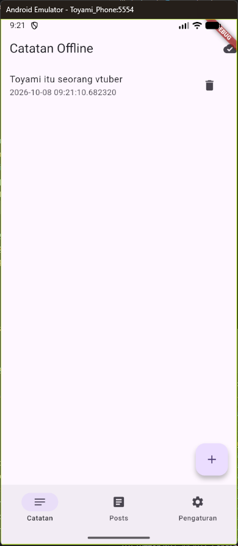
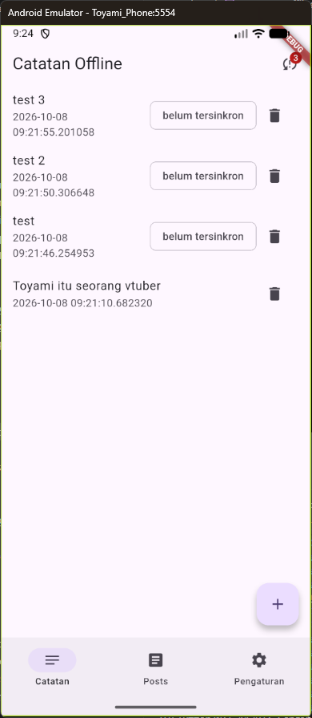
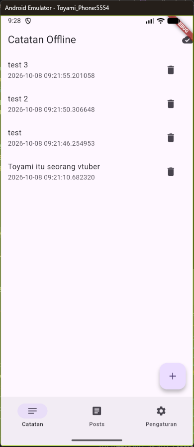
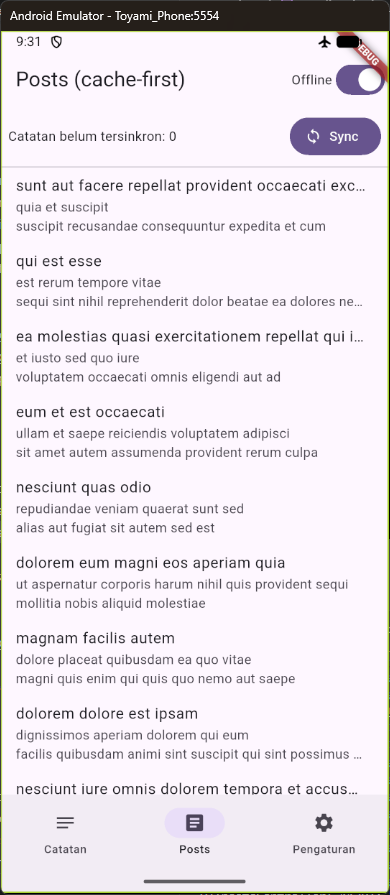
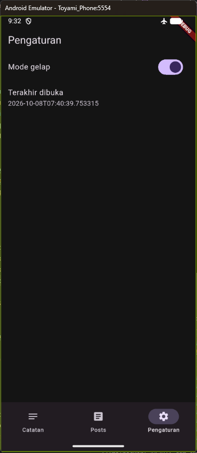

# Laporan Tugas Minggu 05 | Local Storage & Offline First

- **Nama Mahasiswa**: Sultan Nashira Ariva
- **NIM**: 244107020187
- **Tautan Repositori**: [244107020187-mobile-course](https://github.com/sultanariva/244107020187-mobile-course)
- **Status**: ✅

---

## 1. Tujuan

Mempelajari penyimpanan lokal di perangkat (SharedPreferences, SQLite via sqflite, Hive, Drift), membangun aplikasi **Offline Notes** yang tetap berfungsi tanpa koneksi internet, menerapkan pola offline-first (cache-first read, dirty flag, antrean sinkronisasi), serta menampilkan state loading/error/empty/success dengan Riverpod.

## 2. Praktikum 1 — SharedPreferences & Halaman Pengaturan

### 2.1. PrefsRepository

Buat `lib/data/prefs.dart`. Seluruh akses key-value terpusat di repository, bukan tersebar di widget.

```dart
class PrefsRepository {
  static const _darkModeKey = 'dark_mode';
  static const _lastOpenedKey = 'last_opened_at';

  Future<bool> getDarkMode() async {
    final prefs = await SharedPreferences.getInstance();
    return prefs.getBool(_darkModeKey) ?? false;
  }

  Future<void> setDarkMode(bool value) async {
    final prefs = await SharedPreferences.getInstance();
    await prefs.setBool(_darkModeKey, value);
  }

  Future<void> markOpenedNow() async {
    final prefs = await SharedPreferences.getInstance();
    await prefs.setString(_lastOpenedKey, DateTime.now().toIso8601String());
  }

  Future<String?> getLastOpened() async {
    final prefs = await SharedPreferences.getInstance();
    return prefs.getString(_lastOpenedKey);
  }
}
```

### 2.2. Provider dan halaman pengaturan

`lib/pages/settings_page.dart`: provider Riverpod (`AsyncNotifierProvider`) membungkus repository agar hasil ter-cache dan mudah diuji. Widget tidak pernah memanggil `SharedPreferences.getInstance()` langsung.

```dart
final prefsRepositoryProvider = Provider((ref) => PrefsRepository());
final darkModeProvider =
    AsyncNotifierProvider<DarkModeNotifier, bool>(DarkModeNotifier.new);

class DarkModeNotifier extends AsyncNotifier<bool> {
  @override
  Future<bool> build() =>
      ref.watch(prefsRepositoryProvider).getDarkMode();

  Future<void> toggle() async {
    final next = !(state.value ?? false);
    state = const AsyncLoading();
    state = await AsyncValue.guard(() async {
      await ref.read(prefsRepositoryProvider).setDarkMode(next);
      return next;
    });
  }
}
```

### 2.3. Entry point dengan ProviderScope

`lib/main.dart` membungkus aplikasi dengan `ProviderScope`, memakai tema terang/gelap sesuai state `darkModeProvider`, dan navigasi bawah (Catatan, Posts, Pengaturan).

## 3. Praktikum 2 — Model, SQLite, Repository Catatan

### 3.1. Model `Note`

`lib/data/local/note.dart`. Field `dirty` menandai catatan yang belum tersinkron; `fromMap` aman terhadap field yang hilang/null.

```dart
class Note {
  const Note({this.id, required this.title, this.body = '',
    required this.updatedAt, this.dirty = false});
  // ... toMap() dan fromMap() seperti di codelab
}
```

### 3.2. Pembuka database

`lib/data/local/db.dart` membuka `offline_notes.db` sekali dan membuat tabel `notes` (dengan kolom `dirty`) serta `cached_posts` (untuk cache-first read).

### 3.3. NoteRepository

`lib/data/repositories/note_repository.dart` adalah satu-satunya pintu data: `fetchNotes()` (urut `updated_at DESC`), `addNote()` (selalu `dirty: true`), `deleteNote()`, `fetchNoteById()`, `countDirty()`, `markAllSynced()`. Constructor menerima `openDb` agar test dapat menyuntikkan database palsu.

### 3.4. Halaman catatan offline

`lib/pages/notes_page.dart` menampilkan daftar catatan (selalu berfungsi dalam mode pesawat), badge jumlah catatan dirty di AppBar, chip "belum tersinkron" per item, tambah/hapus catatan, dan ketuk item untuk membuka detail via GoRouter.

## 4. Praktikum 3 — Offline-First & Sinkronisasi

### 4.1. Cache-first read

`lib/data/sync.dart`: `loadPostsCacheFirst()` mengembalikan cache SQLite seketika, lalu me-refresh di background hanya saat cache kosong (agar tidak terjadi loop invalidasi provider). Refresh manual via pull-to-refresh di tab Posts.

### 4.2. Sinkronisasi catatan kotor

`syncNotes(repo)` menghitung `countDirty()`, mensimulasikan upload (delay 1 detik), lalu `markAllSynced()`. Karena codelab belum punya backend tulis, yang dinilai adalah mekanismenya.

### 4.3. Simulasi offline deterministik

`forceOfflineProvider` (NotifierProvider boolean) menggantikan kebutuhan mode pesawat sungguhan untuk demo/testing:

- Toggle **Offline** → refresh posts dihentikan, cache tetap tampil, `syncNotes` ditolak dengan pesan "Offline: sync ditunda".
- Toggle kembali **Online** → `syncNotes` dapat dijalankan, badge dirty kembali 0.

Aturan konflik yang didokumentasikan: **last-write-wins** berdasarkan `updated_at`.

## 5. AI Challenge

Prompt, output awal AI, hasil verifikasi, dan keputusan final terdokumentasi di folder [docs](docs):

- [docs/ai_prompt.md](docs/ai_prompt.md)
- [docs/ai_baseline_output.md](docs/ai_baseline_output.md)
- [docs/verification_and_decision.md](docs/verification_and_decision.md)

### 5.1. Prompt yang digunakan

```text
Aplikasi Flutter Offline Notes: CRUD catatan + preferensi tema.
Bandingkan SharedPreferences, Hive, sqflite (SQLite), dan Drift
untuk dua kebutuhan ini. Requirements:
- Kriteria: kompleksitas query, kebutuhan relasi, reaktivitas (stream),
  type-safety, ukuran boilerplate, dan kemudahan testing.
- Beri rekomendasi final: mana untuk preferensi, mana untuk catatan,
  beserta alasannya dalam 1 tabel.
- Tunjukkan skema tabel/kotak untuk 1000+ catatan.
Jelaskan trade-off setiap pilihan.
```

### 5.2. Temuan verifikasi

- Output AI awal memilih **Hive** untuk catatan dan mengklaim Box Hive otomatis "real-time".
- Skema yang disarankan **tidak punya dirty flag** → hanya CRUD polos, antrean sync tidak bisa dibangun.
- Klaim "real-time" hanya asumsi; reaktivitas nyata tetap butuh stream eksplisit (mis. `box.watch()` atau Drift `watch`).
- Boilerplate Hive diremehkan (tetap butuh `TypeAdapter` + `build_runner`).

### 5.3. Keputusan final

| Kebutuhan | Pilihan final | Alasan |
| --- | --- | --- |
| Preferensi (tema, last opened) | SharedPreferences | Nilai primitif kecil, tanpa query |
| Catatan (CRUD + antrean sync) | sqflite (SQLite) | `WHERE dirty = 1`, `ORDER BY updated_at`, kolom dirty untuk antrean sync, repository mudah diuji via injeksi `openDb` |

## 6. Refactoring dan Testing

### 6.1. Refactoring Challenge

- **Baris catatan** diekstrak menjadi widget `NoteTile` (`lib/widgets/note_tile.dart`) dengan badge "belum tersinkron" bila `dirty == true`.
- **Logika cache posts dan `syncNotes`** dipindahkan ke `lib/data/sync.dart` agar `NoteRepository` fokus pada CRUD.
- **Detail catatan** ditambahkan via GoRouter: route `/note/:id` membaca dari `noteRepositoryProvider.fetchNoteById(id)`, bukan dari state halaman list.

### 6.2. Testing: unit test model + repository palsu

`test/note_test.dart` menguji `fromMap` aman null, dirty flag bertahan pada serialisasi, provider sukses, dan provider error — semuanya dengan `FakeNoteRepository` (tanpa SQLite sungguhan).

Error umum yang ditemukan saat testing: FutureProvider Riverpod 3 me-**retry otomatis** ketika error sehingga test provider error menggantung; solusinya menambahkan `retry: (retryCount, error) => null` pada `notesProvider`.

### 6.3. Hasil testing


- `flutter analyze` — No issues found!
- `flutter test` — All tests passed! (5 test)

### 6.4. Checklist Error Umum

| Gejala | Penyebab | Solusi |
| --- | --- | --- |
| `MissingPluginException` shared_preferences/sqflite | Hot reload setelah tambah plugin | Hentikan app, `flutter run` ulang |
| `table notes already exists` | `onCreate` terpanggil 2x / skema berubah tanpa naik versi | Naikkan `version` + `onUpgrade`, atau uninstall saat dev |
| Badge dirty tidak pernah 0 | `markAllSynced` belum dipanggil / UI tidak di-invalidate | Panggil setelah sync sukses; invalidate `notesProvider` **dan** `dirtyCountProvider` |
| UI tidak refresh setelah tambah catatan | Lupa `ref.invalidate(notesProvider)` | Invalidate di caller, bukan widget acak |
| Test menyentuh database sungguhan | Repository asli dipakai | Gunakan `FakeNoteRepository` via override |
| Test provider error menggantung | Retry otomatis Riverpod 3 | `retry: (retryCount, error) => null` |

## 7. Tugas, Refleksi, dan Referensi

### 7.1. Tugas Mini Project

Aplikasi Offline Notes sudah memenuhi: preferensi tema + last opened via SharedPreferences, CRUD catatan via sqflite + Riverpod (urut `updated_at` terbaru), offline-first dengan dirty flag + `syncNotes`, bukti mode pesawat (screenshot), minimal 2 test lulus, dokumentasi AI Challenge di `docs/`, dan struktur `lib/`, `test/`, `docs/`, `screenshots/`, `README.md`.

### 7.2. Refleksi

**Mengapa daftar catatan tidak boleh disimpan di SharedPreferences?**
SharedPreferences hanya untuk nilai primitif kecil. Menyimpan koleksi catatan sebagai satu string JSON besar membuat query, update parsial, dan sinkronisasi menjadi rapuh dan lambat; tidak ada cara melakukan `WHERE dirty = 1` tanpa memuat seluruh string.

**Kapan cache-first cukup?**
Untuk data bacaan yang jarang berubah (mis. daftar posts referensi). Untuk data yang butuh kesegaran tinggi (harga real-time), gunakan network-first.

**Bagaimana dirty flag menjadi antrean sync?**
Setiap perubahan lokal diberi `dirty = 1`; `countDirty()` menghitung antrean, `syncNotes` mengirim lalu `markAllSynced()`. Untuk skala besar, tabel outbox terpisah diperlukan agar operasi tertunda tidak bercampur dengan data utama.

**Bagian mana dari rekomendasi AI yang ditolak?**
Rekomendasi Hive untuk catatan dan klaim "real-time otomatis"-nya. Hive dipilih tidak untuk catatan karena antrean sync butuh query terstruktur yang lebih natural di SQLite.

### 7.3. Bukti Screenshot Aplikasi

**Daftar catatan offline**



**Badge dirty sebelum sync**



**Badge dirty sesudah sync**



**Cache posts tanpa internet**



**Pengaturan (tema)**



## 8. Kesimpulan

Aplikasi Offline Notes berhasil memisahkan tanggung jawab antara repository (satu-satunya pintu data), provider Riverpod (state asynchronous), dan UI. SharedPreferences dipakai untuk preferensi kecil, sedangkan sqflite menyimpan catatan dengan dirty flag dan mendukung cache-first read untuk posts. Pola offline-first membuat aplikasi tetap berfungsi penuh tanpa internet, dan testing dengan repository palsu memungkinkan verifikasi tanpa database sungguhan.
