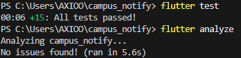
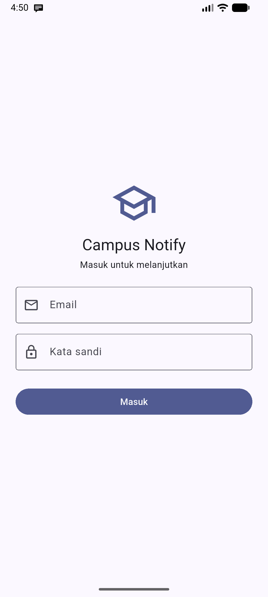
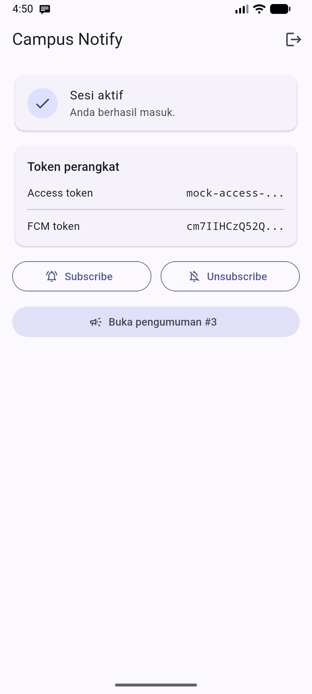
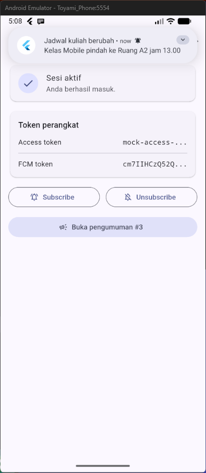
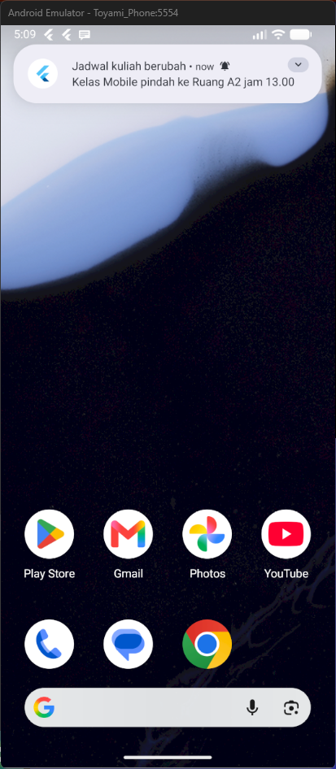
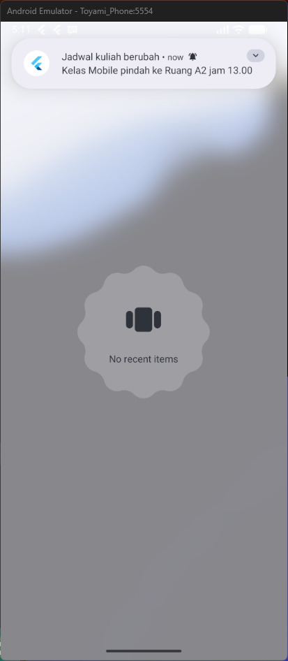
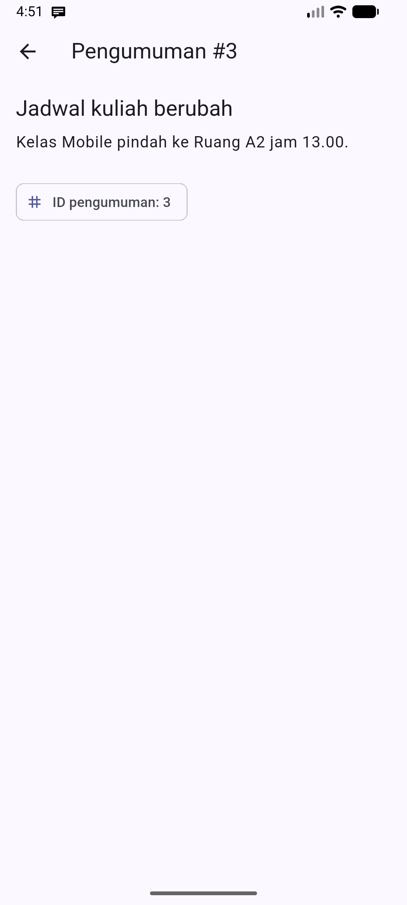

# Laporan Tugas Minggu 06 | Authentication, Security & FCM

- **Nama Mahasiswa**: Sultan Nashira Ariva
- **NIM**: 244107020187
- **Tautan Repositori**: [244107020187-mobile-course](https://github.com/sultanariva/244107020187-mobile-course)
- **Status**: ✅ Selesai — Firebase aktif, token FCM terbit, notifikasi terverifikasi pada 3 app state (foreground/background/terminated)

---

## 1. Tujuan

Mempelajari alur autentikasi (Firebase Auth / JWT / OAuth) dan perbedaan
ID token vs access token vs refresh token, menyimpan token secara aman dengan
secure storage dan refresh otomatis, memahami arsitektur FCM
(app server → Firebase → perangkat), mengelola token lifecycle
(`getToken`, `onTokenRefresh`), membedakan `notification` vs `data` payload
pada tiga app state (foreground/background/terminated), serta menerapkan
prinsip keamanan dasar aplikasi mobile (tidak menyimpan secret di kode,
tidak log token).

## 2. Praktikum 1 — Login + Secure Storage + Token Refresh

### 2.1. Penyimpanan token aman

`lib/data/token_store.dart` adalah satu-satunya pintu keluar-masuk token.
Token disimpan di `flutter_secure_storage` (Keychain/Keystore), **bukan**
SharedPreferences yang tidak terenkripsi.

```dart
class TokenStore {
  Future<void> save({required String access, required String refresh}) async { ... }
  Future<String?> readAccess() => _storage.read(key: _accessKey);
  Future<String?> readRefresh() => _storage.read(key: _refreshKey);
  Future<void> clear() => _storage.deleteAll();
}
```

### 2.2. Repository auth (mock, siap diganti Firebase Auth)

`lib/data/auth_repository.dart` memvalidasi kredensial dan mengembalikan
`AuthSession` (access + refresh). Titik penggantian ke Firebase Auth
(`signInWithEmailAndPassword`) ditandai di komentar.

### 2.3. Dio dengan refresh otomatis

`lib/data/api_client.dart` menyisipkan `Authorization: Bearer <access>` pada
`onRequest`, dan saat **401** mencoba refresh **sekali** lalu mengulang request.
Bila refresh ikut gagal, token dibersihkan sehingga pengguna dipaksa login ulang.

### 2.4. Provider auth + guard route

`lib/providers/auth_provider.dart` menyediakan `tokenStoreProvider`,
`authRepositoryProvider`, `apiClientProvider`, `authStateProvider`
(`AsyncNotifier`), dan `fcmTokenProvider`. Guard route memakai GoRouter di
`lib/main.dart` dengan `refreshListenable` sebagai jembatan Riverpod→GoRouter,
sehingga logout otomatis diarahkan ke `/login` dan login ke `/`.

```dart
redirect: (context, state) {
  final isLoggedIn = loggedIn.value;
  final goingToLogin = state.matchedLocation == Routes.login;
  if (!isLoggedIn && !goingToLogin) return Routes.login;
  if (isLoggedIn && goingToLogin) return Routes.home;
  return null;
},
```

## 3. Praktikum 2 — FCM, Permission, dan Token Lifecycle

### 3.1. Izin notifikasi & notifikasi lokal

`lib/messaging/push_service.dart`: `requestNotificationPermission()` meminta
izin runtime (Android 13+/iOS) dan `initLocalNotifications()` membuat kanal
`pengumuman` (importance high) supaya banner muncul.

### 3.2. Token lifecycle

`initFcmToken()` mengambil token via `getToken()` dan **memantau**
perubahannya lewat `onTokenRefresh.listen(onToken)` (wajib, jika tidak backend
menyimpan token basi), lalu berlangganan topik `pengumuman-kampus`.

### 3.3. Registrasi token ke backend

`lib/main.dart` mengirim token ke `POST /devices` (`{fcm_token, platform}`)
saat startup dan setiap token berubah. `baseUrl` contoh
(`example-campus-api.test`) dapat diganti dengan API kampus asli.

### 3.4. Halaman debug

`lib/pages/home_page.dart` menampilkan access token dan FCM token **terpotong**
(12 karakter + `...`) pada satu kartu "Token perangkat", plus tombol
subscribe/unsubscribe topik. Token penuh tidak pernah di-log.

### 3.5. Konfigurasi Firebase (aktif)

Project Firebase **`campus-notify-7769d`** sudah terpasang:
`android/app/google-services.json` asli untuk package `com.example.campus_notify`.
Setelah `flutter clean` + rebuild, `getToken()` berhasil dan token perangkat
muncul terpotong di halaman Home (lihat `screenshots/02_home_token_truncated.png`).
Izin `POST_NOTIFICATIONS` (Android 13+) juga sudah diberikan di emulator.

## 4. Praktikum 3 — Payload, Tiga App State, Klik & Topik

### 4.1. Payload gabungan

Selalu kirim `notification` (teks untuk manusia) + `data.route` (deep link):

```json
{
  "message": {
    "topic": "pengumuman-kampus",
    "notification": { "title": "Jadwal kuliah berubah", "body": "Kelas Mobile pindah ke Ruang A2 jam 13.00" },
    "data": { "route": "/pengumuman/3", "id": "3" }
  }
}
```

### 4.2. Tiga handler

`bindPushNavigation(router)` menyambungkan tiga handler:

| State | Handler | Aksi |
| --- | --- | --- |
| Foreground | `FirebaseMessaging.onMessage` | tampilkan banner manual (`showLocalNotification`) |
| Background | `FirebaseMessaging.onMessageOpenedApp` | `router.go(routeFromMessage(data))` |
| Terminated | `FirebaseMessaging.instance.getInitialMessage()` | `router.go(routeFromMessage(data))` saat startup |

Background handler `firebaseMessagingBackgroundHandler` adalah **fungsi
top-level** dengan `@pragma('vm:entry-point')` dan **tidak** mengakses
`BuildContext`/Riverpod (berjalan di isolate terpisah).

### 4.3. Matriks pengujian (hasil uji perangkat)

Diuji di emulator Android 17 (API 37) dengan project Firebase nyata
(`campus-notify-7769d`). Pesan FCM dikirim ke topik `pengumuman-kampus`
(channel `pengumuman`) berjudul "Jadwal kuliah berubah" dengan isi
"Kelas Mobile pindah ke Ruang A2 jam 13.00".

| State | Yang diharapkan | Cara uji | Hasil |
| --- | --- | --- | --- |
| Foreground | Banner lokal muncul, klik masuk `/pengumuman/3` | App terbuka, kirim dari console | ✅ Banner muncul di atas halaman Home — `screenshots/03_fcm_foreground.png` |
| Background | Banner sistem muncul, klik masuk rute benar | Tekan Home, kirim, klik banner | ✅ Banner muncul di launcher — `screenshots/04_fcm_background.png` |
| Terminated | App terbuka ke rute benar via `getInitialMessage` | Swipe-close, kirim, klik banner | ✅ Banner muncul saat app ditutup (Recents kosong) — `screenshots/05_fcm_terminated.png` |

Bukti token FCM terbit (terpotong) ada di `screenshots/02_home_token_truncated.png`,
sedangkan halaman tujuan deep link `/pengumuman/3` ada di
`screenshots/07_deep_link_pengumuman_3.png`.

### 4.4. Topic messaging

`subscribeToTopic('pengumuman-kampus')` / `unsubscribeFromTopic(...)`. Aturan:
**topik** untuk broadcast (semua mahasiswa/kelas), **token perangkat** untuk
pesan personal (nilai, tagihan).

## 5. AI Challenge

Prompt, output awal AI, hasil verifikasi, dan keputusan final terdokumentasi di
folder [docs](docs):

- [docs/ai_prompt.md](docs/ai_prompt.md)
- [docs/ai_baseline_output.md](docs/ai_baseline_output.md)
- [docs/verification_and_decision.md](docs/verification_and_decision.md)

### 5.1. Prompt yang digunakan

```text
Aplikasi Flutter Campus Notification App.
Stack: firebase_messaging, flutter_local_notifications,
flutter_secure_storage, go_router, Riverpod.
Buatkan PushService dengan:
- requestPermission + getToken + onTokenRefresh (kirim ke POST /devices)
- onMessage (tampilkan local notification manual)
- onMessageOpenedApp + getInitialMessage (navigasi ke data.route)
- subscribe/unsubscribe topic pengumuman-kampus
- background handler top-level dengan @pragma('vm:entry-point')
Tandai bagian yang BERBEDA untuk Android 13+ vs iOS,
dan bagian yang tidak boleh mengakses BuildContext.
```

### 5.2. Temuan verifikasi

- Draf menaruh background handler **di dalam kelas** → tidak valid; harus
  fungsi top-level + `@pragma('vm:entry-point')`.
- `onTokenRefresh` hanya `debugPrint` → token baru **tidak sampai ke backend**.
- Foreground hanya `debugPrint` → **tanpa** notifikasi lokal, banner tak muncul.
- Klik background tidak dinavigasi dan `getInitialMessage` **absen**.
- Token **dicetak penuh** ke log → melanggar prinsip keamanan.
- API `flutter_local_notifications` yang dipakai sudah usang (posisional).

### 5.3. Keputusan final

Draf AI **ditolak sebagian**: 4 dari 6 checklist langsung diperbaiki sebelum
kode diterima. Keputusan utama kami:

| Aspek | Keputusan | Alasan |
| --- | --- | --- |
| Background handler | Fungsi top-level | Berjalan di isolate tanpa `BuildContext` |
| Token lifecycle | `getToken` + `onTokenRefresh` → `POST /devices` | Backend tak boleh menyimpan token basi |
| Foreground | Local notification manual | Sistem tidak menampilkan banner otomatis |
| Penyimpanan token | Secure storage | SharedPreferences tidak terenkripsi |

## 6. Refactoring dan Testing

### 6.1. Refactoring Challenge

- **Rute terpusat** di `lib/routes.dart` (`/login`, `/pengumuman/:id`) agar deep
  link FCM dan GoRouter memakai konstanta yang sama.
- **`routeFromMessage(Map<String, dynamic>)`** diekstrak jadi fungsi murni di
  `lib/routes.dart` sehingga dapat di-unit test tanpa Firebase.
- **`friendlyApiError()`** memetakan `DioException` → pesan ramah
  (401/timeout/offline/500) di `lib/data/api_errors.dart`; UI (login, topik)
  hanya menerima pesan, bukan exception mentah.

### 6.2. Testing: tanpa Firebase sungguhan

`test/auth_push_test.dart` menguji `routeFromMessage`, validasi login, refresh
token, dan `friendlyApiError`. `test/login_page_test.dart` menguji validasi form
login. Firebase tidak diuji langsung — logika di sekitarnya yang diuji.

### 6.3. Hasil testing



- `flutter analyze` — No issues found!
- `flutter test` — All tests passed! (15 test)

## 7. Tugas, Refleksi, dan Referensi

### 7.1. Tugas Mini Project

Aplikasi **Campus Notification App** sudah memenuhi: login + guard route, token
di secure storage, Dio auto-refresh sekali saat 401 + logout bila refresh mati,
FCM (permission, `getToken` + `onTokenRefresh` ke `POST /devices`, topik
`pengumuman-kampus`), notifikasi gabungan `notification + data` yang membuka
`/pengumuman/:id` (handler tiga state), dokumentasi AI Challenge di `docs/`,
dan struktur `lib/`, `test/`, `docs/`, `screenshots/`, `README.md`.

### 7.2. Refleksi

**Mengapa refresh token tidak boleh disimpan di SharedPreferences?**
SharedPreferences tidak terenkripsi dan mudah dibaca (root/backup/adb). Bila
bocor, penyerang bisa menukarnya menjadi access token baru tanpa login, sehingga
akun dapat diambil alih selama masa berlaku refresh token. Refresh token hanya
boleh di `flutter_secure_storage` (Keychain/Keystore) dan dikirim lewat body
POST HTTPS, tidak pernah di query URL.

**Apa yang rusak bila `onTokenRefresh` diabaikan selama satu semester?**
Token perangkat berubah (reinstall, clear data, rotasi keamanan). Backend yang
menyimpan token lama akan mengirim push ke token basi → notifikasi tidak sampai
ke pengguna. Fitur inti aplikasi (pemberitahuan kampus) diam-diam berhenti
bekerja.

**Kapan memakai topik dan kapan memakai token perangkat?**
Topik untuk **broadcast** (mis. pengumuman seluruh mahasiswa, satu angkatan,
satu UKM) karena semua pelanggan topik menerima pesan yang sama. Token
perangkat untuk **pesan personal** (mis. nilai, tagihan, jadwal ujian pribadi)
yang harus sampai ke satu perangkat milik satu pengguna.

**Bagian mana dari draf AI yang ditolak/perbaiki?**
Background handler di dalam kelas (dipindah jadi top-level), `onTokenRefresh`
yang hanya log (diganti kirim ke backend), foreground tanpa notifikasi lokal
(ditambah `showLocalNotification`), klik tanpa navigasi + `getInitialMessage`
absen (ditambah), token dicetak penuh (dipangkas/terpotong), dan API library
usang (diperbarui ke named parameter).

### 7.3. Bukti Screenshot Aplikasi

Screenshot diambil pada emulator dengan
project Firebase `campus-notify-7769d`.

**Halaman login**



**Token FCM terpotong**



**Notifikasi FCM saat foreground**



**Notifikasi FCM saat background**



**Notifikasi FCM saat app terminated**



**Halaman tujuan deep link `/pengumuman/3`**



## 8. Kesimpulan

Aplikasi Campus Notification App memisahkan tanggung jawab antara repository
(satu-satunya pintu data), provider Riverpod (state asynchronous), dan UI.
Token disimpan aman di `flutter_secure_storage` dengan refresh otomatis di
interceptor Dio. FCM menangani izin, siklus hidup token, dan topik broadcast,
sedangkan deep link dari `data.route` membuka `/pengumuman/:id` pada tiga app
state melalui `routeFromMessage()` yang dapat diuji tanpa Firebase. Verifikasi
manual terhadap draf AI membuktikan bahwa kode yang "terlihat benar" tetap
perlu diuji perilakunya pada perangkat nyata.