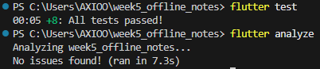
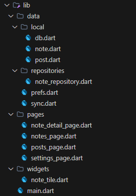
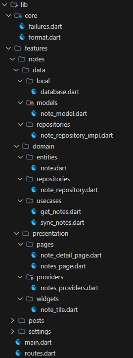

# Laporan Tugas Minggu 07 | Clean Architecture

- **Nama Mahasiswa**: Sultan Nashira Ariva
- **NIM**: 244107020187
- **Tautan Repositori**: [244107020187-mobile-course](https://github.com/sultanariva/244107020187-mobile-course)
- **Status**: ✅

---

## 1. Tujuan

Menerapkan Clean Architecture pada project Flutter yang sudah berjalan:
memisahkan kode menjadi tiga layer (presentation, domain, data) dengan aturan
dependensi mengarah ke dalam, memisahkan entity dari model, menempatkan interface
repository di `domain` dan implementasinya di `data`, memusatkan dependency
injection lewat Riverpod, mengubah exception mentah menjadi `Failure` yang ramah
pengguna, serta menguji use case dengan repository palsu tanpa database atau
jaringan sungguhan.

> Minggu ini **merefactor** project Minggu 5 (`week5_offline_notes`).

## 2. Praktikum 1 — Pemetaan File ke Layer

### 2.1. Pemetaan file ke layer

| File saat ini | Layer saat ini | Masalah |
| --- | --- | --- |
| `lib/pages/notes_page.dart` | presentation | provider (DI) ditulis di file halaman; validasi judul di dalam widget |
| `lib/pages/settings_page.dart` | presentation | provider (DI) ditulis di file halaman |
| `lib/pages/posts_page.dart` | presentation | memanggil `Dio()`/SQLite lewat file `data` langsung |
| `lib/data/local/note.dart` | data | entity bercampur mapping (`toMap`/`fromMap`) |
| `lib/data/local/post.dart` | data | entity bercampur mapping (`fromJson`/`toJson`) |
| `lib/data/local/db.dart` | data | opener DB di luar fitur, dipakai bersama |
| `lib/data/repositories/note_repository.dart` | data | konkret, tanpa interface; tidak ada domain |
| `lib/data/prefs.dart` | data | konkret, tanpa interface; tidak ada domain |
| `lib/data/sync.dart` | data | memuat logika bisnis (`syncNotes`) dan `Dio()` langsung |

### 2.2. Tiga pelanggaran klasik yang ditandai

Pencarian pada project ini menemukan:

- **Tidak ada layer `domain`** sama sekali → semua bergantung ke `data`.
- **Entity bercampur mapping** — `lib/data/local/note.dart` dan `post.dart` memuat
  `toMap/fromMap/fromJson/toJson`.
- **DI bocor ke file halaman** — `notes_page.dart`, `settings_page.dart`, dan
  `sync.dart` mendefinisikan provider sendiri.
- **Import antar-presentation** — `posts_page.dart` mengimpor provider dari
  `notes_page.dart`.

### 2.3. Struktur target

```
lib/
├── core/
│   ├── failures.dart                 # Failure domain (murni Dart)
│   └── format.dart                   # fungsi format murni
├── features/
│   ├── notes/
│   │   ├── domain/
│   │   │   ├── entities/note.dart
│   │   │   ├── repositories/note_repository.dart      # interface!
│   │   │   └── usecases/{get_notes,sync_notes}.dart
│   │   ├── data/
│   │   │   ├── local/database.dart                    # opener SQLite (tabel notes)
│   │   │   ├── models/note_model.dart                 # mapping
│   │   │   └── repositories/note_repository_impl.dart
│   │   └── presentation/
│   │       ├── providers/notes_providers.dart         # DI + state
│   │       ├── pages/{notes_page,note_detail_page}.dart
│   │       └── widgets/note_tile.dart
│   ├── posts/
│   │   ├── domain/
│   │   │   ├── entities/post.dart
│   │   │   ├── repositories/post_repository.dart      # interface!
│   │   │   └── usecases/refresh_posts.dart
│   │   ├── data/
│   │   │   ├── local/database.dart                    # opener SQLite (tabel cached_posts)
│   │   │   ├── models/post_model.dart                 # mapping
│   │   │   └── repositories/post_repository_impl.dart
│   │   └── presentation/
│   │       ├── providers/posts_providers.dart         # DI + state
│   │       └── pages/posts_page.dart
│   └── settings/
│       ├── domain/repositories/prefs_repository.dart  # interface!
│       ├── data/repositories/prefs_repository_impl.dart
│       └── presentation/
│           ├── providers/settings_providers.dart
│           └── pages/settings_page.dart
├── routes.dart                       # GoRouter + konstanta rute + HomeShell
└── main.dart                         # tipis: ProviderScope + MaterialApp.router
```

Di `lib/` hanya ada `core/`, `features/`, `routes.dart`, dan `main.dart` — persis
bentuk feature-first pada codelab. Setiap fitur memiliki opener databasenya
sendiri di layer `data`, sehingga `core` tetap steril dari framework.

**Jangan buat fitur baru.** Praktikum ini memindahkan dan memisahkan kode yang
sudah ada dan sudah jalan.

## 3. Praktikum 2 — Entity, Failure, Repository, dan Use Case

### 3.1. Entity murni (domain)

`lib/features/notes/domain/entities/note.dart` — tanpa import Flutter, tanpa mapping.

```dart
class Note {
  const Note({
    this.id,
    required this.title,
    this.body = '',
    required this.updatedAt,
    this.dirty = false,
  });

  final int? id;
  final String title;
  final String body;
  final DateTime updatedAt;
  final bool dirty;
}
```

### 3.2. Failure dan kontrak repository (domain)

`lib/core/failures.dart` dan `lib/features/notes/domain/repositories/note_repository.dart`:

```dart
sealed class Failure {
  const Failure(this.message);
  final String message;
}

class LocalFailure extends Failure {
  const LocalFailure(super.message);
}

class NetworkFailure extends Failure {
  const NetworkFailure(super.message);
}
```

```dart
abstract class NoteRepository {
  Future<({List<Note> notes, Failure? failure})> fetchNotes();
  Future<({Note? note, Failure? failure})> fetchNoteById(int id);
  Future<({Note? note, Failure? failure})> addNote({
    required String title,
    String body = '',
  });
  Future<({bool ok, Failure? failure})> deleteNote(int id);
  Future<({int count, Failure? failure})> countDirty();
  Future<({bool ok, Failure? failure})> markAllSynced();
}
```

Memakai *record* Dart agar sukses/gagal eksplisit tanpa exception bocor ke presentation.

### 3.3. Model dan implementasi (data)

`lib/features/notes/data/models/note_model.dart` — mapping hanya di sini:

```dart
class NoteModel extends Note {
  const NoteModel({
    super.id,
    required super.title,
    super.body = '',
    required super.updatedAt,
    super.dirty = false,
  });

  Map<String, Object?> toMap() => { /* ... */ };

  factory NoteModel.fromMap(Map<String, Object?> map) { /* ... */ }

  Note toEntity() => Note(
        id: id,
        title: title,
        body: body,
        updatedAt: updatedAt,
        dirty: dirty,
      );
}
```

`lib/features/notes/data/repositories/note_repository_impl.dart` — memakai sqflite,
menangkap exception menjadi `LocalFailure`. Pembuka database disuntikkan agar
mudah diganti fake saat test:

```dart
class NoteRepositoryImpl implements NoteRepository {
  NoteRepositoryImpl(this._openDb);
  final Future<Database> Function() _openDb;

  @override
  Future<({List<Note> notes, Failure? failure})> fetchNotes() async {
    try {
      final db = await _openDb();
      final rows = await db.query('notes', orderBy: 'updated_at DESC');
      final notes = rows.map((r) => NoteModel.fromMap(r).toEntity()).toList();
      return (notes: notes, failure: null);
    } catch (e) {
      return (
        notes: const <Note>[],
        failure: LocalFailure('Gagal membaca catatan: $e'),
      );
    }
  }
  // addNote / fetchNoteById / deleteNote / countDirty / markAllSynced serupa
}
```

### 3.4. Use case: satu operasi bisnis

`lib/features/notes/domain/usecases/get_notes.dart`:

```dart
class GetNotes {
  const GetNotes(this._repository);
  final NoteRepository _repository;

  Future<({List<Note> notes, Failure? failure})> call() {
    return _repository.fetchNotes();
  }
}
```

`lib/features/notes/domain/usecases/sync_notes.dart` — `SyncNotes` memuat logika
nyata (menghitung antrean, menunggu upload, menandai bersih), sehingga layak
menjadi use case.

**Kapan use case perlu?** Bila operasi menggabungkan >1 repository atau punya
aturan bisnis (validasi, sorting, sync). CRUD satu-baris cukup repository →
notifier; pada project ini hanya `GetNotes` dan `SyncNotes` yang dibuat.

## 4. Praktikum 3 — Dependency Injection dan Verifikasi Dependency Rule

### 4.1. Dependency injection dengan Riverpod

`lib/features/notes/presentation/providers/notes_providers.dart` — satu-satunya
tempat wiring:

```dart
// Data layer: database opener disuntikkan (mudah diganti fake saat test).
final noteRepositoryProvider = Provider<NoteRepository>((ref) {
  return NoteRepositoryImpl(openNotesDb);
});

// Domain layer: use case menerima abstraksi, bukan implementasi.
final getNotesProvider = Provider<GetNotes>((ref) {
  return GetNotes(ref.watch(noteRepositoryProvider));
});

final syncNotesProvider = Provider<SyncNotes>((ref) {
  return SyncNotes(ref.watch(noteRepositoryProvider));
});

// Presentation layer: state untuk UI.
final notesProvider = FutureProvider<List<Note>>(
  (ref) async {
    final result = await ref.watch(getNotesProvider).call();
    if (result.failure != null) throw Exception(result.failure!.message);
    return result.notes;
  },
  retry: (retryCount, error) => null,
);
```

### 4.2. Halaman hanya membaca state

`notes_page.dart` versi bersih tidak mengandung SQL, Dio, JSON, atau formatting
tanggal mentah. Format tanggal diekstrak ke `lib/core/format.dart` sebagai fungsi
murni (`formatUpdatedAt`).

```dart
class NotesPage extends ConsumerWidget {
  const NotesPage({super.key});

  @override
  Widget build(BuildContext context, WidgetRef ref) {
    final notes = ref.watch(notesProvider);
    return Scaffold(
      body: notes.when(
        loading: () => const Center(child: CircularProgressIndicator()),
        error: (e, _) => Center(child: Text('Error: $e')),
        data: (items) => items.isEmpty
            ? const Center(child: Text('Belum ada catatan'))
            : ListView.builder(/* ... NoteTile ... */),
      ),
    );
  }
}
```

### 4.3. Verifikasi dependency rule

```powershell
# 1. Presentation steril dari data mentah (harus NOL)
Get-ChildItem -Recurse -File -Include *.dart `
  lib\features\notes\presentation, lib\features\posts\presentation, lib\features\settings\presentation |
  Select-String "Dio\(|openDatabase|getDatabasesPath|FlutterSecureStorage|SharedPreferences\.getInstance|jsonDecode"

# 2. Domain + core steril dari framework & package (harus NOL)
Get-ChildItem -Recurse -File -Include *.dart `
  lib\features\notes\domain, lib\features\posts\domain, lib\features\settings\domain, lib\core |
  Select-String "import 'package:flutter|import 'package:dio|import 'package:sqflite|import 'package:firebase"

# 3. Static analysis + test
flutter analyze
flutter test
```

| Pemeriksaan | Hasil |
| --- | --- |
| Grep 1 — presentation steril dari data mentah | **0 hasil** ✅ |
| Grep 2 — domain steril dari framework & package | **0 hasil** ✅ |
| `flutter analyze` | **No issues found!** ✅ |
| `flutter test` | **All tests passed! (8 test)** ✅ |

**Definisi selesai:** aplikasi berjalan sama seperti sebelum refactor, tiga grep
di atas nol hasil, `flutter analyze` bersih, dan test hijau.

## 5. AI Challenge

Prompt, output awal AI, hasil verifikasi, dan keputusan final terdokumentasi di
folder [docs](docs):

- [docs/ai_prompt.md](docs/ai_prompt.md)
- [docs/ai_baseline_output.md](docs/ai_baseline_output.md)
- [docs/verification_and_decision.md](docs/verification_and_decision.md)

### 5.1. Prompt yang digunakan

```text
Project Flutter saya: week5_offline_notes (catatan offline + posts cache-first + pengaturan tema).
Kondisi kini: folder lib/{data, pages, widgets}, kelas Note bercampur mapping
(toMap/fromMap), NoteRepository konkret tanpa interface, widget/halaman membuat
provider sendiri (DI bocor), dan logika sync catatan ada di layer data.
Tugas:
1. Usulkan struktur feature-first Clean Architecture
   (presentation/domain/data) untuk fitur notes + settings.
2. Untuk tiap file lama, sebutkan tujuan barunya (pindah/pecah/hapus).
3. Tandai bagian yang over-engineering bila diterapkan ke CRUD sederhana,
   dan kapan use case benar-benar dibutuhkan vs repository langsung.
4. Tunjukkan wiring DI dengan Riverpod (tanpa package DI tambahan).
Jelaskan trade-off setiap keputusan.
```

### 5.2. Temuan verifikasi

- Output AI awal menaruh **interface + impl dalam satu file** di `domain/repositories/`.
- AI membuat **use case untuk setiap operasi** (get/add/delete/getById/sync) —
  over-engineering untuk CRUD satu-baris.
- AI membiarkan **mapping menempel di entity** (`toMap/fromMap` tidak dipisah).
- AI menyarankan package **`get_it`** sebagai DI tambahan, padahal codelab
  meminta Riverpod saja.
- Kontrak repository AI membiarkan **exception bocor** ke presentation.

### 5.3. Keputusan final

| Topik | Usulan AI | Keputusan final | Alasan |
| --- | --- | --- | --- |
| Lokasi interface & impl | Satu file di `domain/repositories/` | Interface di `domain`, impl di `data` | Domain tidak boleh tahu SQLite |
| Use case | Semua operasi | `GetNotes`, `SyncNotes`, `RefreshPosts` | CRUD/baca satu-baris = over-engineering; hanya operasi berlogika nyata |
| Entity vs model | Mapping menempel di entity | Entity murni + `NoteModel`/`PostModel` | Entity harus bebas `toMap/fromMap` |
| Kontrak error | Exception bocor | Record `({data, failure})` + `sealed Failure` | Sukses/gagal eksplisit, UI hanya terima `message` |
| DI | Tipe konkret + `get_it` | Provider Riverpod bertipe abstraksi | Codelab: Riverpod saja |
| Fitur kedua | (tidak dibahas) | `settings` (prefs interface + impl) | Jangan biarkan satu fitur bersih dan sisanya kotor |
| Fitur `posts` | (dibiarkan di `lib/data`) | Dipindah jadi `features/posts` 3 layer | Agar `lib/` persis bentuk codelab (tanpa `lib/data`/`lib/pages`) |
| Opener SQLite bersama | (tidak dibahas) | Opener per fitur di layer `data` | `core` harus steril framework agar grep 2 nol hasil |

## 6. Refactoring dan Testing

### 6.1. Refactoring Challenge

- **Fitur kedua (`settings`)** diterapkan dengan pola sama: interface
  `PrefsRepository` di domain, `PrefsRepositoryImpl` (SharedPreferences) di data,
  provider wiring di presentation.
- **Fitur `posts`** direfactor penuh menjadi `features/posts` 3 layer: entity
  `Post` murni, interface `PostRepository`, `PostModel` + impl (Dio + SQLite),
  use case `RefreshPosts`, provider DI, dan halaman dipindah ke `presentation/`.
- **Formatting tanggal** diekstrak ke fungsi murni `formatUpdatedAt` di
  `lib/core/format.dart`, dipakai `note_tile.dart` dan `note_detail_page.dart`.
- **Exception mentah menjadi `Failure`** ramah pengguna di dalam repository impl;
  UI hanya menerima `message`.

### 6.2. Testing: use case dengan repository palsu

`test/get_notes_test.dart` — domain diuji murni, tanpa SQLite/Dio:

```dart
class FakeNoteRepository implements NoteRepository {
  FakeNoteRepository({this.items = const [], this.fail = false});
  final List<Note> items;
  final bool fail;

  @override
  Future<({List<Note> notes, Failure? failure})> fetchNotes() async {
    if (fail) {
      return (notes: const <Note>[],
          failure: const LocalFailure('db locked (simulasi)'));
    }
    return (notes: items, failure: null);
  }
  // method lain throw UnimplementedError()
}

void main() {
  test('GetNotes meneruskan daftar dari repository', () async {
    final repo = FakeNoteRepository(items: [
      Note(title: 'A', updatedAt: DateTime(2026, 9, 27)),
    ]);
    final result = await GetNotes(repo).call();
    expect(result.failure, isNull);
    expect(result.notes.length, 1);
  });

  test('GetNotes meneruskan failure tanpa melempar', () async {
    final repo = FakeNoteRepository(fail: true);
    final result = await GetNotes(repo).call();
    expect(result.failure, isA<LocalFailure>());
    expect(result.notes, isEmpty);
  });
}
```

### 6.3. Hasil testing



- `flutter analyze` — No issues found!
- `flutter test` — All tests passed! (8 test)

### 6.4. Checklist Error Umum

| Gejala | Penyebab | Solusi |
| --- | --- | --- |
| Import cycle / file saling mengimpor | Presentation diimpor oleh domain/data | Hanya presentation → domain ← data; fitur berkomunikasi via rute/provider |
| `The argument type 'NoteModel' can't be assigned to 'Note'` | Repository impl mengembalikan model, kontrak minta entity | Konversi `.toEntity()` di batas data → domain |
| `ref.watch` dipakai di luar widget/provider | Wiring DI ditulis di fungsi biasa | Wiring hanya di dalam `Provider/Notifier` atau `ConsumerWidget` |
| Test butuh database sungguhan | Use case diuji dengan impl SQLite asli | Uji domain dengan fake yang `implements` interface |
| Refactor merusak fitur yang sudah jalan | Tidak ada uji manual per fitur | Uji tiap fitur ±5 menit dan bandingkan screenshot |

### 6.5. Checklist Verifikasi Mandiri

| # | Checklist codelab | Status | Bukti |
| --- | --- | --- | --- |
| 1 | Tiga grep sterilitas (presentation & domain) nol hasil | ✅ | Bagian 4.3 — Grep 1 & Grep 2 **0 hasil** |
| 2 | Interface repository di `domain`, implementasi di `data`, mapping hanya di model | ✅ | `features/*/domain/repositories/*.dart` (interface) vs `features/*/data/repositories/*_impl.dart`; `toMap`/`fromMap`/`toJson` hanya di `NoteModel`/`PostModel` |
| 3 | Widget tidak menginstansiasi repository; semua lewat provider | ✅ | Grep `RepositoryImpl(`/`Repository(` di `lib/features/*/presentation` → **0 hasil** |
| 4 | Aplikasi berjalan identik sebelum/sesudah refactor (bukti screenshot) | ✅ | `screenshots/before_clean_architecture.png` & `screenshots/after_clean_architecture.png` |
| 5 | `flutter analyze` bersih dan semua test lulus | ✅ | Bagian 6.3 — `No issues found!` dan `All tests passed! (8 test)` |


## 7. Tugas, Refleksi, dan Referensi

### 7.1. Tugas Mini Project

Project `week5_offline_notes` telah direfactor menjadi Clean Architecture
feature-first: fitur `notes`, `posts`, dan `settings` terpisah penuh (`domain` +
`data` + `presentation`), sehingga `lib/` hanya berisi `core/`, `features/`,
`routes.dart`, dan `main.dart` — persis bentuk codelab. Dependency rule terbukti
lewat grep, perilaku identik dengan sebelum refactor, 8 test lulus (termasuk use
case sukses + failure dengan repository palsu), dan AI Challenge terdokumentasi
di `docs/`.

### 7.2. Refleksi

**Mengapa interface repository harus tinggal di domain, bukan di data?**
Karena domain adalah pemilik kebutuhan bisnis. Jika interface ditaruh di data,
domain harus mengimpor data untuk mendefinisikan kontraknya — arah dependensi
terbalik dan domain tidak lagi bisa diuji tanpa SQLite/Dio.

**Kapan use case benar-benar dibutuhkan?**
Saat operasi menggabungkan >1 repository atau punya aturan bisnis (validasi,
sorting, sync). CRUD satu-baris lebih baik langsung repository → notifier.

**Apa biaya over-engineering bagi tim kecil?**
Setiap use case per-CRUD menambah file, boilerplate, dan lapisan yang harus dibaca
tanpa nilai tambah. Biaya sepadan saat logika mulai bercabang.

**Bagian mana dari usulan AI yang ditolak atau disederhanakan?**
Interface+impl dalam satu file, use case untuk semua operasi, `get_it` sebagai DI
tambahan, dan mapping yang menempel di entity — semuanya ditolak dengan alasan
tertulis di `docs/verification_and_decision.md`.

### 7.3. Bukti Screenshot Before/After (Arsitektur)

**Before**



**After**



## 8. Kesimpulan

Project Minggu 5 berhasil direfactor menjadi Clean Architecture feature-first.
Aplikasi berjalan identik, tetapi dependensi kini mengarah ke dalam: presentation
bergantung pada domain, domain tidak tahu apa pun tentang Flutter/Dio/SQLite, dan
data mengimplementasikan kontrak domain. Pemisahan entity dari model, kontrak
record `({data, failure})`, serta DI terpusat di Riverpod membuat logika bisnis
dapat diuji murni dengan repository palsu.
