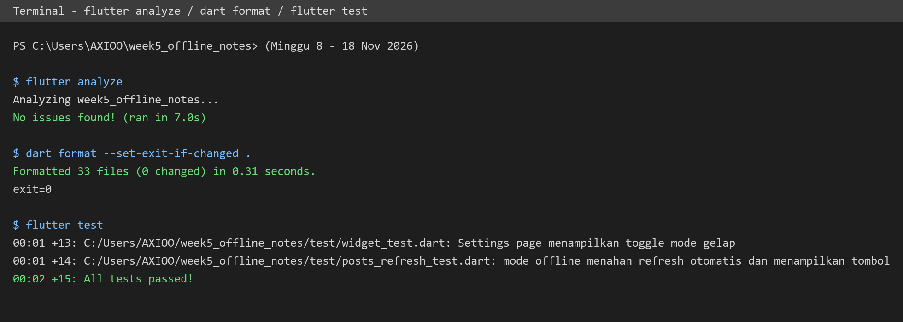
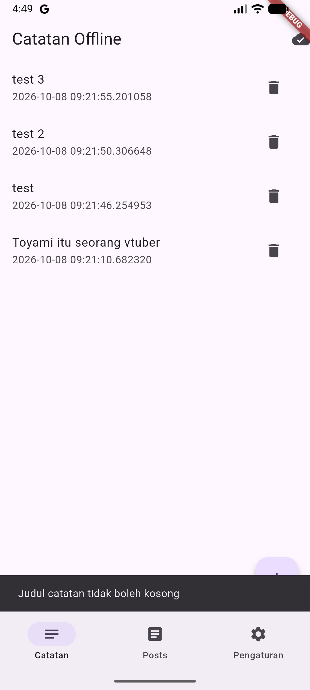
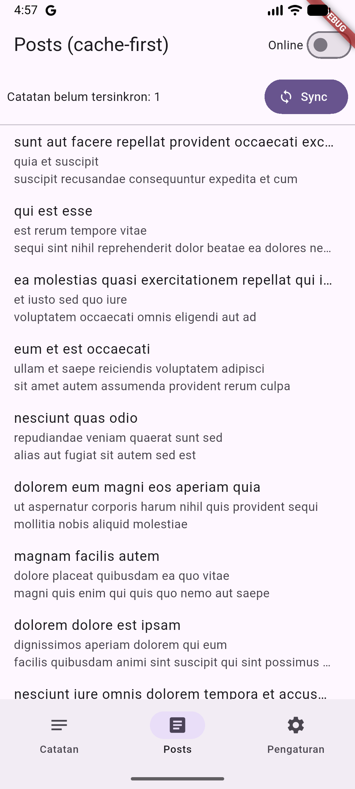

# Laporan Tugas Minggu 08 | Mid Project Review & Code Review

- **Nama Mahasiswa**: Sultan Nashira Ariva
- **NIM**: 244107020187
- **Tautan Repositori**: [244107020187-mobile-course](https://github.com/sultanariva/244107020187-mobile-course)
- **Status**: ✅

---

## 1. Tujuan

Menilai kesiapan project tengah semester tanpa menambah fitur: menerapkan Git Flow
(`main`, `develop`, `feature/*`, `fix/*`), menulis commit dan Pull Request yang
layak direview, melakukan code review terstruktur, menjalankan tiga gerbang mesin
(`flutter analyze`, `dart format`, `flutter test`), serta memverifikasi saran AI
sebelum diterapkan.

> Minggu ini **mereview dan memperbaiki** project hasil refactor Minggu 7
> (`week5_offline_notes`), bukan membuat project baru. Tidak ada fitur baru yang
> ditambahkan.

---

## 2. Praktikum 1 — Hygiene branch dan commit

### 2.1. Git Flow yang diterapkan

Sebelum Minggu 8, repository hanya punya `main` dan seluruh commit Minggu 1-7
masuk langsung ke sana. Mulai Minggu 8 alur diubah:

| Branch | Peran | Perlakuan |
| --- | --- | --- |
| `main` | Rilis yang selalu bisa dijalankan | Hanya menerima merge dari `develop` |
| `develop` | Integrasi mingguan, target semua PR | Dibuat dari `main` pada 18 Nov 2026 |
| `feature/notes-validate-empty-title` | Satu fitur: validasi judul catatan | PR #2, sudah di-merge lalu dihapus |
| `fix/posts-refresh-self-invalidation` | Satu perbaikan: refresh cache Posts | PR #4, sudah di-merge lalu dihapus |

Riwayat branch setelah minggu ini:

```text
* a1ea4d8 Merge pull request #4 from sultanariva/fix/posts-refresh-self-invalidation
* 22737ea Merge pull request #2 from sultanariva/feature/notes-validate-empty-title
* 7505a06 fix(posts): jangan invalidate postsProvider dari dalam dirinya sendiri
* e3bcf1f feat(notes): validasi judul kosong di use case + test
* 5c9fa4c style: terapkan dart format pada baseline Minggu 8
* 7706d5b chore: salin baseline project Minggu 7 ke folder Minggu 8
```

Dua commit terakhir adalah pekerjaan persiapan (menyalin baseline dan merapikan
format) yang sengaja dipisah agar diff PR tetap kecil dan bisa dibaca reviewer.

### 2.2. Commit berkualitas

Satu commit = satu perubahan logis yang bisa direview dan di-revert:

```text
baik : feat(notes): validasi judul kosong di use case + test
baik : fix(posts): jangan invalidate postsProvider dari dalam dirinya sendiri
baik : style: terapkan dart format pada baseline Minggu 8
jelek: fix bug / update / final fix beneran   (tidak dipakai)
```

Body commit menjelaskan **mengapa**, misalnya pada `fix(posts)`:

```text
PostsPage memuat ulang cache dari widget (Ref widget tetap valid) setelah
refresh jaringan berhasil. Provider tidak lagi memanggil
ref.invalidate(postsProvider) dari build-nya sendiri yang memicu
'A provider cannot depend on itself'.

Refs #3
```

### 2.3. Anatomi Pull Request

| PR | Judul | Ukuran | Isi body |
| --- | --- | --- | --- |
| [#2](https://github.com/sultanariva/244107020187-mobile-course/pull/2) | `feat(notes)`: validasi judul kosong di use case + test | 5 file, +159 −10 | Masalah → Solusi → Cara uji → Screenshot → Ukuran PR |
| [#4](https://github.com/sultanariva/244107020187-mobile-course/pull/4) | `fix(posts)`: pindahkan refresh cache ke widget | 5 file, +188 −36 | idem + logcat sebelum/sesudah |

Keduanya di bawah batas 300 baris. `flutter analyze` bersih dan `flutter test`
hijau sebelum PR diminta direview.

### 2.4. Issue tracking

| Nomor | Jenis | Isi | Status |
| --- | --- | --- | --- |
| [#1](https://github.com/sultanariva/244107020187-mobile-course/issues/1) | Issue | Tombol Simpan diam saja saat judul kosong | Ditutup oleh PR #2 |
| [#3](https://github.com/sultanariva/244107020187-mobile-course/issues/3) | Issue | Tab Posts melempar `A provider cannot depend on itself` | Ditutup oleh PR #4 |
| [#5](https://github.com/sultanariva/244107020187-mobile-course/issues/5) | Issue | `TextEditingController` tidak pernah di-dispose | Terbuka, dijadwalkan Minggu 9 |

Issue #3 lahir dari **menjalankan** aplikasi di emulator, bukan dari membaca kode.
Itulah alasan codelab menegaskan "review tanpa dijalankan tidak sah".

---

## 3. Praktikum 2 — Code review

### 3.1. Keterbatasan yang dinyatakan lebih dulu

Repository ini hanya punya satu akun GitHub, sehingga tidak ada reviewer sejawat
independen. Review di PR #2 dan PR #4 dikerjakan penulis sendiri dengan prosedur
reviewer: checkout branch, membaca diff, menjalankan tiga gerbang mesin, menguji
manual di emulator, lalu menulis komentar review dan keputusan di PR.

Klaim "sudah di-merge via review sejawat" **tidak** bisa dipenuhi apa adanya, dan
tidak diklaim. Yang bisa dibuktikan: branch, issue, PR, komentar review, dan
keputusan merge tercatat di GitHub.

### 3.2. Temuan review

Setiap review memuat 2 temuan kebenaran, 1 temuan arsitektur, 1 temuan test, dan
1 saran keterbacaan. Ringkasan temuan yang benar-benar menjadi pekerjaan:

| # | Temuan | Jenis | Bukti | Tindak lanjut |
| --- | --- | --- | --- | --- |
| 1 | Judul kosong tidak pernah sampai ke pengguna karena validasi ada di widget | kebenaran | Reproduksi manual: tombol Simpan diam saja | PR #2 |
| 2 | Pembatalan dialog harus dibedakan dari judul kosong, kalau tidak pengguna melihat error palsu | kebenaran | Uji manual: Escape/batal tidak memunculkan SnackBar | PR #2 |
| 3 | `postsProvider` meng-invalidate dirinya sendiri | kebenaran (blocker) | Logcat: `A provider cannot depend on itself` di `posts_providers.dart:55` | PR #4 |
| 4 | Empty state Posts tidak punya jalan keluar, padahal teksnya menyuruh "Tarik untuk memuat" | kebenaran | Reproduksi manual di emulator | PR #4 |
| 5 | Refresh dipicu presentation lewat use case, bukan `AsyncNotifier` | arsitektur | Diff `posts_page.dart` | Utang teknis, dicatat di `docs/review-checklist.md` |
| 6 | Widget test perlu override `dirtyCountProvider` agar tidak membuka SQLite | test | `test/posts_refresh_test.dart` | Sudah diterapkan |
| 7 | Pesan error dipusatkan di `AddNote.emptyTitleMessage` | keterbacaan | Dipakai UI dan test | Sudah diterapkan |

### 3.3. Pola komentar review

Komentar ditulis dengan pola **observasi → dampak → usulan konkret**, bukan
penilaian rasa:

```text
Kurang : "validasinya salah, pindahkan"
Baik   : "Validasi judul ada di dalam widget (observasi), sehingga pengguna tidak
          menerima pesan apa pun saat judul kosong (dampak).
          Usul: pindahkan aturan ke use case AddNote dan tampilkan
          result.failure.message lewat SnackBar (usulan)."
```

Komentar lengkap tersimpan di PR #2 dan PR #4 (review berstatus *commented*),
termasuk pernyataan risiko karena review tidak independen.

### 3.4. Keputusan

| PR | Keputusan | Catatan |
| --- | --- | --- |
| #2 | **Approve** | Risiko: tidak ada reviewer kedua; dimitigasi dengan test + uji manual |
| #4 | **Approve** | Utang teknis (`AsyncNotifier`) dicatat, tidak dikerjakan di PR ini |

---

## 4. Praktikum 3 — Hygiene mesin dan nilai kesiapan

### 4.1. Tiga perintah wajib

```text
$ flutter analyze
No issues found! (ran in 7.0s)

$ dart format --set-exit-if-changed .
Formatted 33 files (0 changed) in 0.31 seconds.

$ flutter test
All tests passed! (15 test)
```



### 4.2. Temuan yang harus diperbaiki dulu

`dart format --set-exit-if-changed .` **gagal** pada awal Minggu 8: 14 file belum
terformat sejak Minggu 7. Perbaikan dikerjakan sebagai commit tersendiri
(`style: terapkan dart format pada baseline Minggu 8`) agar diff fitur tidak
tercampur perubahan format. Setelah itu formatter menjadi gerbang yang objektif,
sehingga PR tidak lagi menghabiskan waktu untuk debat spasi.

### 4.3. Nilai kesiapan tengah semester

Dokumen penilaian lengkap ada di [docs/review-checklist.md](docs/review-checklist.md).
Ringkasnya:

| Aspek | Status | Bukti |
| --- | --- | --- |
| Struktur feature-first | ✅ | Grep sterilitas: presentation 0 akses data mentah, domain 0 import framework |
| `flutter analyze` | ✅ | `No issues found!` |
| `dart format` | ✅ | `0 changed` |
| `flutter test` | ✅ | 15 test lulus |
| PR kecil + commit jelas | ✅ | 2 PR, masing-masing 5 file < 300 baris |
| Review ditindaklanjuti | ✅ dengan 1 utang | 2 temuan diperbaiki, 1 dicatat sebagai issue #5 |
| Review sejawat independen | ❌ tidak tersedia | Repo single-owner, dinyatakan terbuka |

**Definisi selesai mid review** menurut codelab: aplikasi berjalan identik dengan
akhir Minggu 7, tiga pemeriksaan mesin hijau, minimal 1 PR kecil di-merge via
review, dan README memuat status paruh semester serta peta issue/PR. Semua
terpenuhi kecuali satu: review dilakukan mandiri, bukan oleh sejawat.

---

## 5. AI Challenge

Prompt, output awal AI apa adanya, tabel verifikasi, dan keputusan final tersimpan
di [docs/ai-review-vs-keputusan.md](docs/ai-review-vs-keputusan.md).

### 5.1. Prompt yang digunakan

```text
Review PR Flutter ini sebagai senior Flutter dev.
Konteks: feature-first Clean Architecture (presentation -> domain <- data),
Riverpod, GoRouter, SQLite + Dio.
PR 1: use case AddNote memvalidasi judul kosong (ValidationFailure) dan
UI menampilkan SnackBar.
PR 2: pemicu refresh cache Posts dipindah dari postsProvider ke PostsPage.
Fokus: kebenaran, arsitektur, dan test. Abaikan style.
Berikan 5 temuan teratas + level (blocker/saran) + alasan + usulan potongan kode
perbaikan.
```

### 5.2. Hasil verifikasi

Dari 7 temuan AI: **3 diterima** (2 dikerjakan, 1 ditunda dengan issue) dan
**4 ditolak** dengan alasan tertulis.

| Temuan AI | Keputusan | Alasan singkat |
| --- | --- | --- |
| Provider meng-invalidate dirinya sendiri (blocker) | Diterima, PR #4 | Terbukti di logcat |
| Empty state Posts tanpa aksi (blocker) | Diterima, PR #4 | Terbukti saat dijalankan |
| `TextEditingController` tidak di-dispose | Diterima, issue #5 | Bukti grep: 1 deklarasi, 0 `dispose()` |
| Validasi judul pindah ke `TextFormField` validator | Ditolak | Aturan bisnis harus bisa diuji tanpa widget; codelab minta use case |
| `trim()` dipindah ke repository | Ditolak | Data layer bukan pemilik aturan bisnis |
| `AddNote` melempar exception | Ditolak | Membatalkan kontrak `({data, failure})` Minggu 7 |
| Rapikan urutan import manual | Ditolak | Ditangani `dart format` (0 changed) |

### 5.3. Saran AI yang gagal saat diuji

Usulan AI untuk temuan pertama adalah menghitung refresh lewat
`postsRefreshTickProvider` yang diawasi `postsProvider`. Implementasi itu diuji dan
**gagal**:

```text
Expected: <1>   Actual: <0>   (networkCalls tidak bertambah)
Ref of FutureProvider<List<Post>>#a05e1 ... has been disposed
```

`Ref` milik provider sudah dibuang sebelum refresh selesai, jadi menaikkan state
provider lain dari dalamnya tidak bisa diandalkan. Keputusan akhir menyimpang dari
saran AI: pemicu refresh dipindahkan ke `PostsPage` sebagai
`ConsumerStatefulWidget`, tempat `Ref` milik widget tetap valid.

---

## 6. Refactoring dan Testing

### 6.1. Refactoring Challenge

| Butir codelab | Yang dikerjakan |
| --- | --- |
| Terapkan komentar review lalu minta re-review | Komentar review PR #2 dan #4 ditindaklanjuti dalam PR yang sama sebelum merge |
| Pindahkan temuan gaya berulang ke otomatisasi | `dart format` dijalankan menyeluruh (14 file) sebagai commit terpisah, sehingga tidak perlu komentar gaya manual |
| Perkecil satu PR besar menjadi beberapa PR kecil | Pekerjaan Minggu 8 dipecah menjadi 2 PR (masing-masing 5 file) + 2 commit persiapan, bukan satu PR besar |

### 6.2. Perubahan perilaku yang benar-benar terjadi

**a. Validasi judul catatan (PR #2).** Aturan "judul wajib diisi" pindah dari widget
ke use case, memakai `ValidationFailure` baru:

```dart
// lib/features/notes/domain/usecases/add_note.dart
Future<({Note? note, Failure? failure})> call({
  required String title,
  String body = '',
}) {
  final cleanTitle = title.trim();
  if (cleanTitle.isEmpty) {
    return Future.value((
      note: null,
      failure: const ValidationFailure(emptyTitleMessage),
    ));
  }
  return _repository.addNote(title: cleanTitle, body: body.trim());
}
```

**b. Refresh cache Posts (PR #4).** Provider tidak lagi me-refresh dirinya sendiri:

```dart
// lib/features/posts/presentation/providers/posts_providers.dart
final postsProvider = FutureProvider<List<Post>>((ref) async {
  final result = await ref.watch(postRepositoryProvider).fetchCachedPosts();
  if (result.failure != null) return const <Post>[];
  return result.posts;
});
```

```dart
// lib/features/posts/presentation/pages/posts_page.dart
@override
void initState() {
  super.initState();
  WidgetsBinding.instance.addPostFrameCallback((_) => _refreshIfCacheEmpty());
}
```

### 6.3. Bukti uji manual di emulator

Emulator `Toyami_Phone` (Android 17 / API 37, `emulator-5554`), aplikasi dijalankan
dengan `flutter run -d emulator-5554`.

| Skenario | Bukti |
| --- | --- |
| Simpan catatan tanpa judul → SnackBar `Judul catatan tidak boleh kosong` | `screenshots/02_validasi_judul_kosong.png` |
| Simpan catatan dengan judul valid → muncul di urutan teratas, badge belum tersinkron | `screenshots/01_daftar_catatan.png` |
| Tab Posts dengan cache kosong sebelum perbaikan → empty state tanpa aksi + exception di logcat | `screenshots/03_posts_sebelum_perbaikan.png` |
| Tab Posts setelah perbaikan → 9 post termuat otomatis, `grep -c "Unhandled Exception"` = 0 | `screenshots/04_posts_setelah_perbaikan.png` |





### 6.4. Error umum yang muncul (dan penyelesaiannya)

| Gejala | Penyebab di project ini | Solusi yang dipakai |
| --- | --- | --- |
| `dart format --set-exit-if-changed` gagal | 14 file belum terformat sejak Minggu 7 | Commit `style:` terpisah, lalu jadikan gerbang |
| `A provider cannot depend on itself` | `ref.invalidate(postsProvider)` dari dalam `postsProvider` | Pemicu refresh dipindah ke widget |
| `Cannot use the Ref ... after it has been disposed` | Percobaan memakai `Ref` provider setelah build selesai | Dibatalkan setelah test membuktikan; pindah ke `Ref` widget |
| Test provider selalu `networkCalls = 0` | Riverpod 3 membuang provider tanpa listener | `container.listen(...)` pada skenario yang memang butuh provider hidup |
| Widget test gagal membuka SQLite | `dirtyCountProvider` ikut dibaca halaman Posts | Override provider di test |

### 6.5. Checklist verifikasi mandiri

| # | Checklist codelab | Status | Bukti |
| --- | --- | --- | --- |
| 1 | Branch dari `develop`, PR kecil satu fitur, issue tertutup via PR | ✅ | Bagian 4.2 `docs/review-checklist.md`: #1 → PR #2, #3 → PR #4 |
| 2 | Minimal 3 komentar review bermakna ditindaklanjuti hingga approve | ✅ | Komentar review di PR #2 (5 butir) dan PR #4 (5 butir) |
| 3 | `flutter analyze` bersih, `dart format` rapi, `flutter test` hijau | ✅ | Bagian 4.1, screenshot `05_hasil_test.png` |
| 4 | Tabel usulan AI vs keputusan final terdokumentasi di `docs/` | ✅ | `docs/ai-review-vs-keputusan.md` Bagian 2-3 |

---

## 7. Tugas, Refleksi, dan Referensi

### 7.1. Status paruh semester

| Butir | Isi |
| --- | --- |
| Fitur utama | Catatan offline (CRUD + sinkronisasi), Posts cache-first (Dio + SQLite), Pengaturan tema |
| Stack | Flutter 3.47.7 / Dart 3.13.5, Riverpod 3.4.3, GoRouter 18, sqflite 2.4.4, Dio 5.11, shared_preferences 2.5 |
| Arsitektur | Feature-first Clean Architecture: `presentation -> domain <- data`, `core` steril framework |
| Test | 15 test (unit domain, model, provider, widget) |
| Gerbang mesin | analyze bersih, format 0 changed, 15 test lulus |
| Bug ditemukan & diperbaiki | 2 (validasi judul kosong, self-invalidate Posts) |
| Issue terbuka | 1 (#5, `TextEditingController` tidak di-dispose) |
| Keterbatasan | Review mandiri, bukan sejawat independen |

### 7.2. Refleksi

**Apa beda LGTM buta dengan approve yang bertanggung jawab?**
LGTM buta berhenti di "kodenya kelihatan benar". Approve yang bertanggung jawab
menjalankan aplikasi dan test lebih dulu, lalu menuliskan apa yang diperiksa dan
risiko yang tersisa. Pada Minggu 8 bedanya konkret: membaca kode tidak
memunculkan bug `A provider cannot depend on itself`; baru terlihat setelah tab
Posts dibuka di emulator.

**Kapan komentar wajib berstatus request changes, dan kapan cukup saran?**
Request changes bila ada perilaku yang salah atau jalan buntu bagi pengguna
(dua blocker Minggu 8). Cukup saran bila kode berjalan benar tetapi bisa lebih
jelas atau lebih mudah diuji (misalnya memusatkan pesan error). Untuk PR sendiri,
status review tidak bisa `approve` (GitHub menolak), sehingga keputusan ditulis di
body review.

**Bagian mana dari review AI yang ditolak atau disederhanakan, dan mengapa?**
Empat temuan ditolak: validator di UI, `trim` di repository, exception menggantikan
kontrak record, dan perapian import manual. Semuanya bertentangan dengan keputusan
arsitektur Minggu 7 atau sudah ditangani formatter. Satu temuan diterima tetapi
usulannya diubah karena implementasi awal AI gagal saat diuji.

**Satu hal konkret yang diperbaiki setelah review, dan dampaknya?**
Validasi judul dipindah ke use case. Dampaknya: pengguna kini menerima pesan
`Judul catatan tidak boleh kosong` alih-alih tombol yang diam, dan aturan tersebut
punya 4 test yang berjalan tanpa widget maupun database.

### 7.3. Referensi

- [Codelab Minggu 8: Mid Project Review & Code Review](https://jti-polinema.github.io/flutter-codelab/08-minggu-8-mid-project-review-code-review/index.html)
- [Atlassian: GitFlow workflow](https://www.atlassian.com/git/tutorials/comparing-workflows/gitflow-workflow)
- [GitHub: About pull request reviews](https://docs.github.com/en/pull-requests/collaborating-with-pull-requests/reviewing-changes-in-pull-requests/about-pull-request-reviews)
- [Conventional Commits 1.0.0](https://www.conventionalcommits.org/en/v1.0.0/)
- [Dart: Linter rules](https://dart.dev/tools/linter-rules)
- [Riverpod: Ref dan provider lifecycle](https://riverpod.dev/docs/concepts/about_code_generation)

---

## 8. Kesimpulan

Minggu 8 tidak menambah fitur, tetapi mengubah cara kerja: alur Git Flow dipakai
sejak commit pertama, dua perubahan kecil masuk lewat issue dan PR yang direview,
dan tiga gerbang mesin menjadi syarat sebelum merge. Dua bug perilaku ditemukan
karena aplikasi benar-benar dijalankan, bukan dari membaca kode: validasi judul
yang tidak pernah memberi umpan balik, dan provider Riverpod yang meng-invalidate
dirinya sendiri.

Saran AI dipakai sebagai pemeriksa awal, bukan keputusan: 3 dari 7 temuan diterima,
4 ditolak dengan alasan teknis tertulis, dan 1 usulan teknis AI justru gagal saat
diuji sehingga pendekatannya diganti. Fondasi project siap dilanjutkan ke paruh
kedua, dengan satu keterbatasan yang dinyatakan terbuka: review dilakukan mandiri
karena repository hanya punya satu akun, bukan oleh sejawat independen.
