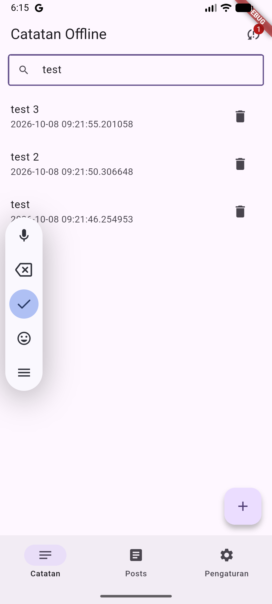
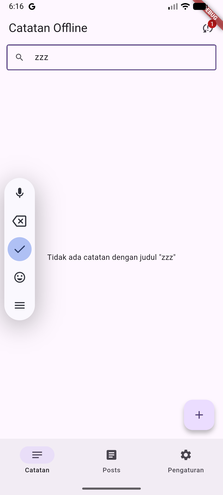
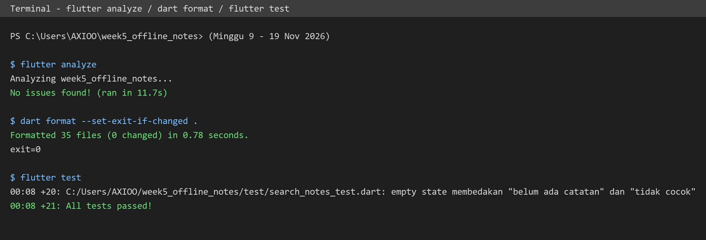

# Laporan Tugas Minggu 09 | AI-Assisted Development

- **Nama Mahasiswa**: Sultan Nashira Ariva
- **NIM**: 244107020187
- **Tautan Repositori**: [244107020187-mobile-course](https://github.com/sultanariva/244107020187-mobile-course)
- **Status**: ✅

---

## 1. Tujuan

Menambah **satu fitur kecil** (pencarian judul catatan + empty state) dengan bantuan
AI, mengikuti alur yang bisa dipertanggungjawabkan: prompt → generate → verify →
test → refactor → explain. Codelab ini juga menilai kemampuan mengenali halusinasi
AI, memindahkan logika ke Clean Architecture, dan mendokumentasikan keputusan
terima/tolak di `docs/ai-log.md`.

> Project yang dipakai adalah `week5_offline_notes` hasil Minggu 7-8. Tidak ada
> project baru, dan tidak ada schema database yang diubah.

---

## 2. Praktikum 1 — Prompt dan konteks

Prompt memuat lima slot: tujuan, arsitektur, larangan, konteks, dan bukti verifikasi.

```text
Tambah fitur pencarian judul catatan pada halaman Catatan (NotesPage).

Tujuan: pengguna bisa mengetik kata kunci di kolom cari, daftar langsung
tersaring berdasarkan judul, dan muncul empty state saat tidak ada yang cocok.
Sertakan 1 widget test untuk empty state.

Arsitektur: feature-first Clean Architecture (presentation -> domain <- data).
Aturan filter HARUS berupa use case murni di domain (tanpa Flutter, tanpa
SQLite). Widget tidak boleh memanggil SQLite atau repository untuk menyaring.

Larangan: jangan ubah schema database, jangan pindahkan CRUD yang sudah jalan,
jangan pakai package baru, jangan menyentuh fitur posts dan settings.

Konteks yang ditempel:
- lib/features/notes/domain/entities/note.dart (id, title, body, updatedAt, dirty)
- lib/features/notes/domain/usecases/get_notes.dart (gaya use case)
- lib/features/notes/presentation/providers/notes_providers.dart (Riverpod 3.4.3)
- lib/features/notes/presentation/pages/notes_page.dart
- pubspec.yaml: flutter_riverpod ^3.4.3, go_router ^18.0.2, sqflite ^2.4.4+1,
  dio ^5.11.1, shared_preferences ^2.5.6

Bukti yang kuharapkan: potongan kode per file, lalu flutter analyze + flutter test
dan uji manual 3 query (kosong, cocok, tak cocok).
```

Tidak ada token, API key, atau data pribadi yang ditempel ke prompt. Detail prompt
dan output awal AI ada di [docs/ai-log.md](docs/ai-log.md).

---

## 3. Praktikum 2 — Generate, verify, dan test

### 3.1. Halusinasi API yang tertangkap

Draft pertama AI memakai `StateProvider` untuk menyimpan kata kunci. Analisis
statis menolaknya, bukan asumsi penulis:

```text
$ flutter analyze
  error - The function 'StateProvider' isn't defined ... -
  lib\features\notes\presentation\providers\notes_providers.dart:61:33 -
  undefined_function
1 issue found. (ran in 43.1s)
```

Diverifikasi ke paket yang benar-benar terpasang (Riverpod 3.4.3):
`StateProvider` hanya ada di `riverpod-3.4.3/lib/src/providers/legacy/`, dan
`flutter_riverpod.dart` tidak mengekspornya. Keputusan: **ditolak**, diganti
`NotifierProvider` yang polanya sudah dipakai `ForceOfflineNotifier` di fitur posts.

### 3.2. Cek API dan batas layer

| Pemeriksaan | Perintah | Hasil |
| --- | --- | --- |
| Nama method/kelas benar-benar ada | `flutter analyze` | **No issues found!** |
| Domain bebas framework | `grep -rn "import 'package:flutter\|import 'package:dio\|import 'package:sqflite" lib/features/notes/domain lib/core \| wc -l` | **0** |
| Presentation bebas akses data mentah | `grep -rho "Dio(\|openDatabase(\|getDatabasesPath(\|jsonDecode(" lib/features/*/presentation \| wc -l` | **0** |

### 3.3. Test

| File | Isi | Jumlah |
| --- | --- | --- |
| `test/search_notes_test.dart` | aturan filter (kosong, huruf besar/kecil, trim, tidak cocok), error diteruskan, widget test empty state | 6 |
| Test minggu sebelumnya | domain notes, posts, settings | 15 |
| **Total** | | **21** |

Contoh dua test yang diminta codelab:

```dart
test('pencarian tidak peduli huruf besar/kecil', () {
  expect(search(_notes(), 'BELANJA'), hasLength(2));
  expect(search(_notes(), 'belanja'), hasLength(2));
});

test('kata kunci tanpa kecocokan mengembalikan daftar kosong', () {
  expect(search(_notes(), 'zzz-tak-ada'), isEmpty);
});
```

### 3.4. Uji manual di emulator

Emulator `Toyami_Phone` (Android 17 / API 37), database berisi 5 catatan.

| Query | Hasil nyata | Bukti |
| --- | --- | --- |
| kosong | 5 catatan tampil | `screenshots/01_semua_catatan.png` |
| `test` | 3 catatan (`test 3`, `test 2`, `test`) | `screenshots/02_pencarian_cocok.png` |
| `zzz` | `Tidak ada catatan dengan judul "zzz"` | `screenshots/03_empty_state.png` |





---

## 4. Praktikum 3 — Refactor ke Clean Architecture

Kode hasil AI dirapikan dengan aturan dependency yang sama seperti Minggu 7:

```text
widget (NotesPage: UI saja)
  -> provider (visibleNotesProvider: menyusun data)
  -> use case (SearchNotes: aturan filter, murni Dart)
  -> repository (SQLite lewat GetNotes yang sudah ada)
```

Hasil akhir `SearchNotes`:

```dart
class SearchNotes {
  const SearchNotes();

  List<Note> call(List<Note> notes, String query) {
    final keyword = query.trim().toLowerCase();
    if (keyword.isEmpty) return List<Note>.unmodifiable(notes);
    return notes
        .where((note) => note.title.toLowerCase().contains(keyword))
        .toList(growable: false);
  }
}
```

Yang dikerjakan pada langkah refactor:

- Filter dipindah penuh dari widget ke `domain/usecases/search_notes.dart`.
- `visibleNotesProvider` hanya menyusun data (`notesProvider` + kata kunci), tidak
  menyimpan logika pencarian.
- Halaman membedakan dua empty state: `Belum ada catatan` dan
  `Tidak ada catatan dengan judul "..."`.
- Tidak ada import lintas layer baru; grep sterilitas tetap 0.
- Tidak ada package baru yang ditambahkan.

---

## 5. AI Challenge

Prompt review yang dipakai:

```text
Review kode search Flutter ini sebagai senior dev.
Konteks: feature-first (presentation->domain<-data), Riverpod, SQLite + Dio.
Fokus: kebenaran, arsitektur, test. Abaikan style.
Beri 3 temuan + level blocker/saran + alasan.
```

| # | Temuan AI | Level | Keputusan | Bukti / alasan |
| --- | --- | --- | --- | --- |
| R1 | Perilaku `toLowerCase().contains()` harus diuji, bukan diasumsikan | saran | **Diterima** | 2 unit test eksplisit (huruf besar/kecil, trim) |
| R2 | `whenData` berisiko menelan error menjadi daftar kosong | saran | **Diterima**, test ditambahkan | `error notesProvider diteruskan, bukan berubah jadi daftar kosong`: `state.hasError` benar, `state.hasValue` salah |
| R3 | Pencarian sebaiknya dipindah ke SQL (`WHERE title LIKE ?`) | saran | **Ditolak**, alasan tertulis | Lihat di bawah |

**Alasan menolak R3:** memindahkan pencarian ke SQL berarti setiap ketikan memicu
query database baru (butuh debounce dan state loading tambahan), padahal daftar
catatan sudah dibaca utuh oleh `fetchNotes()`. Lebih penting: aturan "cocokkan
judul, abaikan besar-kecil huruf" adalah aturan bisnis yang harus bisa diuji tanpa
SQLite, dan codelab Minggu 9 meminta filter berada di use case domain yang murni.

Syarat codelab terpenuhi: minimal 1 temuan AI terbukti benar (R1, R2) dan minimal
1 ditolak dengan alasan teknis (R3). Tabel lengkap keputusan per file ada di
[docs/ai-log.md](docs/ai-log.md) Bagian 4-5.

---

## 6. Refactoring, Testing, dan Error Umum

### 6.1. Gerbang mesin

```text
$ flutter analyze
No issues found! (ran in 11.7s)

$ dart format --set-exit-if-changed .
Formatted 35 files (0 changed) in 0.78 seconds.

$ flutter test
All tests passed! (21 test)
```



### 6.2. Error umum yang muncul

| Gejala | Penyebab di project ini | Solusi |
| --- | --- | --- |
| `The function 'StateProvider' isn't defined` | Halusinasi API: Riverpod 3 memindahkan `StateProvider` ke library legacy | Ganti `NotifierProvider` + `Notifier` |
| Widget test mencoba membuka SQLite | `dirtyCountProvider` ikut dibaca halaman | Override provider di dalam `ProviderScope` |
| Test provider melihat state `AsyncLoading` | Riverpod 3 membuang provider tanpa listener | `container.listen(...)` lalu `addTearDown(sub.close)` |

### 6.3. Checklist verifikasi mandiri

| # | Checklist codelab | Status | Bukti |
| --- | --- | --- | --- |
| 1 | Prompt 5 slot + konteks tercatat di `docs/ai-log.md` | ✅ | `docs/ai-log.md` Bagian 1 |
| 2 | `flutter analyze` bersih dan `flutter test` hijau | ✅ | Bagian 6.1, screenshot `04_hasil_test.png` |
| 3 | 1 temuan AI dibuktikan benar + 1 ditolak beralasan | ✅ | R1/R2 diterima, R3 ditolak (Bagian 5) |
| 4 | Filter ada di use case domain, widget tidak menyaring sendiri | ✅ | `lib/features/notes/domain/usecases/search_notes.dart` |
| 5 | Fitur kecil + empty state + uji manual 3 query | ✅ | Screenshot 01-03 |
| 6 | Bisa menjelaskan setiap keputusan tanpa membuka AI | ✅ | Refleksi Bagian 7.2 |

---

## 7. Tugas, Refleksi, dan Referensi

### 7.1. Status pekerjaan

| Butir | Isi |
| --- | --- |
| Fitur baru | Pencarian judul catatan + dua empty state |
| File baru | `domain/usecases/search_notes.dart`, `test/search_notes_test.dart` |
| File diubah | `providers/notes_providers.dart`, `pages/notes_page.dart` |
| Stack | Flutter 3.47.7 / Dart 3.13.5, Riverpod 3.4.3, GoRouter 18, sqflite 2.4.4, Dio 5.11 |
| Issue dan PR | Issue [#6](https://github.com/sultanariva/244107020187-mobile-course/issues/6), PR [#7](https://github.com/sultanariva/244107020187-mobile-course/pull/7) (4 file, +170 −2) |
| Gerbang mesin | analyze bersih, format 0 changed, 21 test lulus |
| Uji manual | 3 query di emulator, semua sesuai harapan |

Cara menjalankan:

```bash
cd C:/Users/AXIOO/week5_offline_notes
flutter pub get
flutter run -d emulator-5554
```

Folder minggu ini berisi salinan artefak (`lib/`, `test/`, `docs/`,
`screenshots/`), tanpa `pubspec.yaml`, jadi tidak bisa dijalankan langsung dari sini.

### 7.2. Refleksi

**Satu halusinasi AI apa yang ditemukan dan bagaimana membuktikannya?**
AI memakai `StateProvider` yang tidak lagi diekspor `flutter_riverpod.dart` di
Riverpod 3. Buktinya bukan opini: `flutter analyze` gagal dengan
`undefined_function` di baris 61, lalu kelasnya kucari di paket yang benar-benar
terpasang dan hanya ditemukan di folder `legacy`. Perbaikannya memakai
`NotifierProvider`.

**Prompt mana yang paling membantu, dan apa yang diubah?**
Slot "Larangan" paling berpengaruh: tanpa itu, hasil AI cenderung ikut menyentuh
fitur lain dan mengubah schema. Yang kuubah pada prompt berikutnya adalah menambah
permintaan bukti (analyze + test + uji manual), sehingga jawaban AI ikut
menyertakan cara memverifikasi, bukan hanya kode.

**Satu refactor apa yang dilakukan pada kode AI?**
Filter dipindah dari widget ke use case `SearchNotes` di domain. Setelah refactor,
halaman tidak lagi tahu cara mencocokkan judul; ia hanya menampilkan hasil
`visibleNotesProvider`. Efeknya, aturan pencarian punya 4 test murni yang berjalan
tanpa widget dan tanpa SQLite.

**Keputusan terima/tolak mana yang paling sulit?**
Menolak R3 (pencarian di SQL). Secara intuitif query `LIKE` terlihat "lebih benar"
karena lebih hemat memori. Yang membuatnya ditolak: untuk aplikasi catatan pribadi
jumlah barisnya kecil, sedangkan biaya memindahkannya (debounce, state loading,
aturan bisnis pindah ke data layer) lebih besar daripada manfaatnya, dan codelab
meminta aturan filter ada di domain.

### 7.3. Referensi

- [Codelab Minggu 9: AI-Assisted Development](https://jti-polinema.github.io/flutter-codelab/09-minggu-9-ai-assisted-development-vibe-coding/index.html)
- [Slide Week 9](https://jti-polinema.github.io/flutter-codelab/00-slides/Week_09_AI_Assisted_Development_Vibe_Coding.html)
- [Riverpod: Getting started](https://riverpod.dev/docs/introduction/getting_started)
- [Flutter: Using IDEs and static analysis](https://docs.flutter.dev/tools/using-ide)
- [GitHub Copilot: Best practices](https://docs.github.com/en/copilot/using-copilot-coding-agent/best-practices)
- [Dart Language Tour](https://dart.dev/guides/language/language-tour)

---

## 8. Kesimpulan

Satu fitur kecil (pencarian judul catatan) ditambahkan dengan bantuan AI, tetapi
yang menentukan kualitasnya adalah langkah setelah generate: halusinasi
`StateProvider` tertangkap `flutter analyze`, aturan pencarian dipindah ke use case
murni di domain, dan perilakunya dibuktikan 6 test baru plus uji manual 3 query di
emulator. Dari tiga temuan review AI, dua diterima (satu di antaranya menambah test
pembuktian) dan satu ditolak dengan alasan arsitektur tertulis.

Fondasi Minggu 7-8 tidak berubah: dependency rule tetap terjaga (grep 0), tidak ada
package baru, dan seluruh 21 test lulus.
