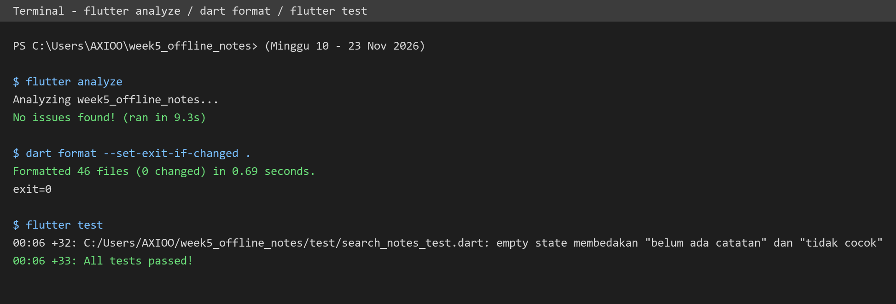
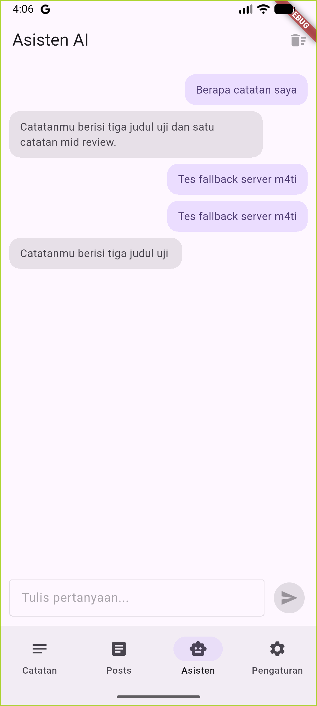
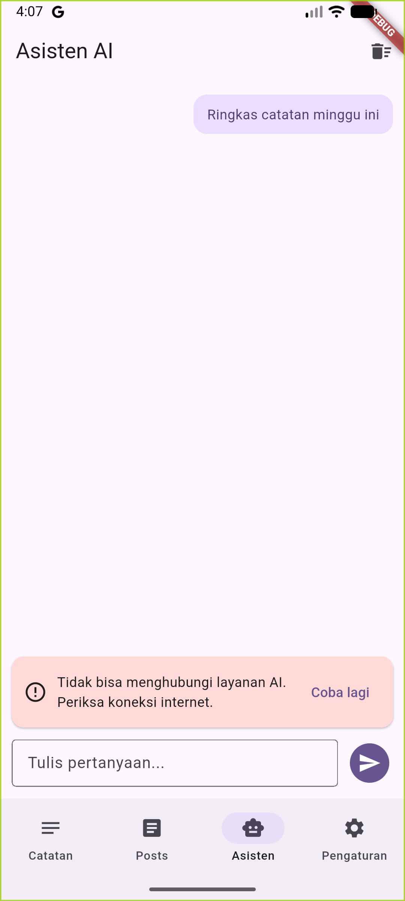

# Laporan Tugas Minggu 10 | Integrasi Fitur AI

- **Nama Mahasiswa**: Sultan Nashira Ariva
- **NIM**: 244107020187
- **Tautan Repositori**: [244107020187-mobile-course](https://github.com/sultanariva/244107020187-mobile-course)
- **Status**: ✅

---

## 1. Tujuan

Mengintegrasikan **satu fitur AI** ke project yang sudah berjalan: asisten chat
dengan **streaming response**, API key yang disimpan aman, penanganan biaya, dan
fallback saat layanan gagal. Fitur ini ditambahkan ke `week5_offline_notes`
(hasil Minggu 7-9), bukan project baru.

---

## 2. Praktikum 1 — Dependensi dan AI service

### 2.1. Adaptasi dependensi

Codelab menyarankan `http`, `flutter_secure_storage`, dan `riverpod ^2.5.0`.
Project ini sudah memakai Dio dan Riverpod 3, jadi hanya satu package yang benar-benar
ditambahkan:

| Kebutuhan | Codelab | Yang dipakai di project | Alasan |
| --- | --- | --- | --- |
| Klien HTTP | `http ^1.2.0` | `dio ^5.11.1` (sudah ada) | Sudah dipakai fitur Posts; `ResponseType.stream` dipakai untuk SSE |
| Penyimpanan key | `flutter_secure_storage ^9.0.0` | `flutter_secure_storage ^11.2.0` | Versi saat ini di pub.dev; API tetap sama |
| State | `riverpod ^2.5.0` | `flutter_riverpod ^3.4.3` (sudah ada) | Downgrade akan merusak fitur Minggu 8-9 |

`flutter pub add flutter_secure_storage` tidak mengubah versi dependency lain
(`flutter_riverpod`, `dio`, `sqflite`, `go_router` tetap).

### 2.2. Struktur fitur

```text
lib/features/assistant/
├── domain/
│   ├── entities/chat_message.dart              ChatRole (system/user/assistant)
│   ├── repositories/assistant_repository.dart  AssistantRepository + AiConfigRepository
│   └── usecases/ask_assistant.dart             system prompt, batas riwayat, validasi
├── data/
│   ├── sse_parser.dart                         parsing baris SSE (murni)
│   ├── local/secure_ai_config_store.dart       flutter_secure_storage
│   └── repositories/assistant_repository_impl.dart  Dio + stream
└── presentation/
    ├── providers/assistant_providers.dart      ChatNotifier + ChatState
    └── pages/assistant_page.dart               bubble, composer, fallback
```

Pengaturan AI (API key + base URL) ada di `features/settings/presentation/pages/settings_page.dart`
sebagai kartu terpisah, dan tab **Asisten** ditambahkan di `routes.dart`.

### 2.3. System prompt dan batas biaya

```dart
// domain/usecases/ask_assistant.dart
static const String systemPrompt =
    'Kamu asisten catatan pribadi yang ramah. Jawab dalam Bahasa Indonesia, '
    'maksimal 3 kalimat, dan jangan meminta atau menampilkan data pribadi.';

static const int maxHistory = 6;
```

Riwayat lebih dari 6 pesan dipotong dari depan, sehingga biaya token tidak tumbuh
tanpa kendali saat percakapan panjang.

---

## 3. Praktikum 2 — Chat interface dengan streaming

### 3.1. Alur dari UI ke provider AI

```text
TextField + tombol kirim
  -> ChatNotifier.send(question)
  -> AskAssistant (validasi + system prompt + potong riwayat)
  -> AssistantRepositoryImpl (Dio POST stream: true)
  -> SseParser (potongan "data: {...}")
  -> ChatState.streamingText  -> bubble diperbarui bertahap
```

### 3.2. State percakapan

```dart
// presentation/providers/assistant_providers.dart
final buffer = StringBuffer();
await for (final delta in result.stream!) {
  buffer.write(delta);
  state = state.copyWith(streamingText: buffer.toString());
}
final answer = buffer.toString().trim();
state = ChatState(messages: [...state.messages, ChatMessage.assistant(answer)]);
```

Selama stream berjalan, `isStreaming` bernilai `true`: tombol kirim dinonaktifkan,
dan bubble asisten menampilkan indikator sampai potongan pertama tiba.

### 3.3. Parsing SSE tanpa HTTP

```dart
// data/sse_parser.dart
String? parseLine(String line) {
  final trimmed = line.trim();
  if (trimmed.isEmpty || !trimmed.startsWith('data:')) return null;
  final payload = trimmed.substring('data:'.length).trim();
  if (payload.isEmpty || payload == doneToken) return null;
  ...
}
```

Dipisah sebagai kelas murni agar format streaming bisa diuji 5 kasus tanpa server.

### 3.4. Payload yang benar-benar dikirim

Bukti dari log mock server saat aplikasi dijalankan di emulator:

```json
{"model":"inferhub/cb/deepseek-v4.1-flash","stream":true,
 "messages":[
   {"role":"system","content":"Kamu asisten catatan pribadi yang ramah. ..."},
   {"role":"user","content":"Ringkas jumlah catatanku"}]}
```

Versi pertama mengirim system prompt dengan `"role":"user"`; temuan ini dan
perbaikannya dicatat di [docs/ai-log.md](docs/ai-log.md) Bagian 3.

---

## 4. Praktikum 3 — Privasi, biaya, error handling, dan fallback

### 4.1. Tabel risiko dan mitigasi

| Risiko | Dampak | Mitigasi yang diterapkan | Bukti |
| --- | --- | --- | --- |
| API key bocor lewat repository | Kunci dipakai pihak lain, biaya membengkak | Key tidak ada di kode; diisi pengguna di Pengaturan | `grep -rnE "(sk-[A-Za-z0-9]{10,}\|AIza[0-9A-Za-z_-]{20,})" lib` = **0 hasil**; `screenshots/01_pengaturan_api_key.png` |
| API key terbaca aplikasi lain atau backup | Penyalahgunaan key | Disimpan di `flutter_secure_storage` (Keystore), bukan SharedPreferences | `data/local/secure_ai_config_store.dart` |
| Data pribadi terkirim ke model | Kebocoran privasi | System prompt melarang meminta/menampilkan data pribadi; riwayat dibatasi | `AskAssistant.systemPrompt`, `maxHistory` |
| Biaya token membengkak | Tagihan provider | Riwayat maks 6 pesan, jawaban diminta maks 3 kalimat, tanpa auto-retry berulang | `ask_assistant.dart` + test batas riwayat |
| Traffic tidak terenkripsi | Key/isi percakapan disadap | Cleartext hanya untuk `10.0.2.2`/`127.0.0.1`; sisanya wajib HTTPS | `android/app/src/main/res/xml/network_security_config.xml` |
| Izin jaringan tidak ada | Request gagal di release build | `INTERNET` ditambahkan ke `AndroidManifest.xml` (sebelumnya 0 kemunculan) | `android/app/src/main/AndroidManifest.xml` |
| Uji coba memakai key asli | Biaya nyata saat pengembangan | Uji memakai mock server lokal dengan key `dummy-key` | `screenshots/02`-`04` |

### 4.2. Fallback yang tersedia

| Kondisi | Perilaku aplikasi |
| --- | --- |
| API key belum diisi | Banner "API key belum diatur" + tombol "Cek ulang", tanpa mencoba request |
| Key ditolak provider (401/403) | Kartu error "API key ditolak provider. Periksa kembali key di Pengaturan." |
| Kuota/rate limit (429) | "Kuota atau rate limit provider tercapai. Coba lagi nanti." |
| Koneksi gagal/timeout | "Tidak bisa menghubungi layanan AI. Periksa koneksi internet." + tombol **Coba lagi** |
| Jawaban kosong dari provider | Pesan "Provider mengirim jawaban kosong. Coba lagi." |

Tombol **Coba lagi** mengirim ulang pertanyaan terakhir tanpa mengetik ulang.

---

## 5. AI Challenge

Prompt, output awal, lima masalah yang tertangkap, dan keputusan per temuan ada di
[docs/ai-log.md](docs/ai-log.md).

### 5.1. Tiga temuan review atas kode hasil AI

| # | Temuan | Level | Keputusan |
| --- | --- | --- | --- |
| R1 | System prompt dikirim sebagai `user`, bukan `system` | blocker | **Diterima**, diperbaiki + unit test |
| R2 | Simpan API key di SharedPreferences agar sederhana | saran | **Ditolak**, bertentangan dengan syarat privasi codelab |
| R3 | Parsing SSE dipisah dari repository agar bisa diuji tanpa HTTP | saran | **Diterima**, `SseParser` murni + 5 test |

Syarat codelab (minimal 1 temuan diterima dengan bukti, minimal 1 ditolak dengan
alasan) terpenuhi: R1 dibuktikan lewat log server, R2 ditolak dengan alasan
tertulis.

### 5.2. Halusinasi/kekeliruan AI yang tertangkap

| Jenis | Contoh nyata di sesi ini | Cara membuktikan |
| --- | --- | --- |
| Path import salah kedalaman | `Target of URI doesn't exist: '../../../core/failures.dart'` | `flutter analyze` |
| API berubah antar versi | `DioExceptionType.transformTimeout` tidak tertangani di `switch` | `flutter analyze` (`non_exhaustive_switch_statement`) |
| Logika yakin tapi salah | System prompt berperan sebagai pesan pengguna | Log server mock + unit test kontrak `roleName` |

---

## 6. Refactoring, Testing, dan Error Umum

### 6.1. Gerbang mesin

```text
$ flutter analyze
No issues found! (ran in 9.3s)

$ dart format --set-exit-if-changed .
Formatted 46 files (0 changed) in 0.69 seconds.

$ flutter test
All tests passed! (33 test)
```



Rincian 12 test baru:

| File | Isi | Jumlah |
| --- | --- | --- |
| `test/ask_assistant_test.dart` | validasi kosong, system prompt + urutan pesan, kontrak `roleName`, batas riwayat | 4 |
| `test/sse_parser_test.dart` | delta normal, `[DONE]`, komentar/baris kosong, delta tanpa content, JSON rusak | 5 |
| `test/assistant_page_test.dart` | peringatan API key kosong, streaming sampai utuh, fallback error | 3 |

Bukti batas layer (dijalankan dari project nyata):

| Pemeriksaan | Perintah | Hasil |
| --- | --- | --- |
| Domain bebas framework | `grep -rn "import 'package:flutter\|import 'package:dio\|import 'package:sqflite" lib/features/assistant/domain lib/core \| wc -l` | **0** |
| Presentation tidak menyentuh Dio | `grep -rc "dio\|Dio(" lib/features/assistant/presentation/*/*.dart` | **0** di kedua file |
| Tidak ada API key tertanam | `grep -rnE "(sk-[A-Za-z0-9]{10,}\|AIza[0-9A-Za-z_-]{20,})" lib \| wc -l` | **0** |

### 6.2. Uji manual di emulator

Emulator `Toyami_Phone` (Android 17 / API 37). Endpoint uji: mock server lokal
yang berbicara protokol [OI]-compatible, diakses emulator lewat `http://10.0.2.2:8787/v1`.

| Skenario | Hasil nyata | Bukti |
| --- | --- | --- |
| Simpan API key + base URL | "Tersimpan di penyimpanan terenkripsi perangkat." | `01_pengaturan_api_key.png` |
| Jawaban mengalir bertahap | Potongan demi potongan tampil | `03_streaming_sebagian.png` |
| Jawaban lengkap | "Catatanmu berisi tiga judul uji dan satu catatan mid review." | `02_chat_jawaban_lengkap.png` |
| Server dimatikan | Kartu error + tombol Coba lagi | `04_error_fallback.png` |
| Coba lagi setelah server hidup | Jawaban normal, kartu error hilang | `02_chat_jawaban_lengkap.png` |





Catatan jujur: panggilan ke provider sungguhan (inferhub/Gemini) tidak dilakukan
pada sesi ini karena tidak ada API key yang boleh dipakai. Yang dibuktikan adalah
seluruh jalur aplikasi terhadap server yang berbicara protokol sama.

### 6.3. Error umum dan solusinya

| Gejala | Penyebab | Solusi |
| --- | --- | --- |
| `401/403` dari provider | Key salah atau kedaluwarsa | Pesan khusus di UI; perbaiki key di Pengaturan |
| Error hanya muncul sebagai exception mentah | `DioException` bocor ke presentation | Semua tipe dipetakan ke `Failure` berbahasa Indonesia |
| Jawaban tidak bertahap | `stream: true` tidak dikirim atau respons dibaca sebagai utuh | `ResponseType.stream` + `SseParser` per baris |
| Aplikasi crash di release, jalan di debug | Izin `INTERNET` hanya ada di debug manifest | Izin ditambahkan ke manifest utama |
| `Cleartext HTTP traffic not permitted` | Android memblokir HTTP polos | `network_security_config` untuk `10.0.2.2`/`127.0.0.1` saja |

### 6.4. Checklist verifikasi mandiri

| # | Checklist codelab | Status | Bukti |
| --- | --- | --- | --- |
| 1 | Satu fitur AI terintegrasi (chat streaming) | ✅ | `lib/features/assistant/**` |
| 2 | System prompt, user prompt, dan output awal AI di `docs/ai-log.md` | ✅ | `docs/ai-log.md` Bagian 1-2 |
| 3 | Bukti `flutter analyze` + `flutter test` di README | ✅ | Bagian 6.1 |
| 4 | Tabel risiko + mitigasi privasi dan biaya | ✅ | Bagian 4.1 |
| 5 | `lib/`, `docs/`, `README.md`, `screenshots/` di folder minggu | ✅ | folder ini |
| 6 | Fallback saat layanan AI error | ✅ | Bagian 4.2 + screenshot 04 |

---

## 7. Tugas, Refleksi, dan Referensi

### 7.1. Status pekerjaan

| Butir | Isi |
| --- | --- |
| Fitur AI | Chat asisten dengan streaming response |
| File baru | 8 file di `lib/features/assistant/`, 3 file test, 1 `network_security_config.xml` |
| File diubah | `routes.dart` (tab Asisten), `settings_page.dart` (kartu AI), `failures.dart`, `AndroidManifest.xml`, `pubspec.yaml` |
| Provider | [OI]-compatible (`POST {baseUrl}/chat/completions`), default `https://api.inferhub.dev/v1` |
| Issue dan PR | Issue [#8](https://github.com/sultanariva/244107020187-mobile-course/issues/8), PR [#9](https://github.com/sultanariva/244107020187-mobile-course/pull/9) (fitur) dan PR [#10](https://github.com/sultanariva/244107020187-mobile-course/pull/10) (refactor batas layer) |
| Gerbang mesin | analyze bersih, format 0 changed, 33 test lulus |

Catatan struktur folder: minggu ini menyertakan `pubspec.yaml` dan dua file
Android (`AndroidManifest.xml`, `network_security_config.xml`) karena fitur AI
mengubah dependensi dan konfigurasi platform. Minggu 3-9 hanya membawa `lib/`,
`test/`, `docs/`, `screenshots/`.

Cara menjalankan:

```bash
cd C:/Users/AXIOO/week5_offline_notes
flutter pub get
flutter run -d emulator-5554
# lalu: tab Pengaturan → isi API key provider (dan base URL bila perlu) → Simpan
# tab Asisten → tulis pertanyaan → kirim
```

Untuk menguji tanpa biaya token, jalankan mock SSE lokal di PC lalu isi base URL
`http://10.0.2.2:8787/v1` pada aplikasi.

### 7.2. Refleksi

**Fitur AI mana yang diintegrasikan dan mengapa?**
Chat asisten dengan streaming. Dipilih karena paling sesuai dengan pola data
aplikasi ini (pengguna punya catatan yang ingin diringkas atau ditanyakan) dan
karena streaming memaksa penanganan state yang jujur: loading, potongan yang
masuk bertahap, dan kegagalan di tengah jalan.

**Bagaimana privasi pengguna dilindungi?**
API key tidak pernah ditulis di kode dan tidak disimpan di SharedPreferences;
key masuk ke `flutter_secure_storage`. System prompt melarang meminta data
pribadi, riwayat dibatasi 6 pesan, dan aplikasi tidak mengirim catatan pengguna
kecuali pengguna menyebutkannya sendiri di pertanyaan.

**Fallback apa yang disediakan bila layanan AI error?**
Kartu error yang bisa ditindaklanjuti: pesan spesifik per penyebab (timeout,
koneksi, key ditolak, kuota) plus tombol **Coba lagi** yang mengirim ulang
pertanyaan terakhir. Bila key belum diisi, aplikasi berhenti sebelum request dan
mengarahkan ke Pengaturan, bukan gagal di tengah jalan.

**Satu hal yang dipelajari tentang UX fitur AI di mobile?**
Indikator loading saja tidak cukup. Yang membuat streaming terasa hidup adalah
teks yang benar-benar bertambah di layar, dan itu hanya bisa dibuktikan dengan
melihatnya berjalan. Bug `role: user` pada system prompt lolos dari analyze dan
unit test, tetapi langsung terlihat di log server saat aplikasi dijalankan.

### 7.3. Referensi

- [Codelab Minggu 10: Integrasi Fitur AI](https://jti-polinema.github.io/flutter-codelab/10-minggu-10-ai-feature-integration/index.html)
- [Slide Week 10](https://jti-polinema.github.io/flutter-codelab/00-slides/Week_10_AI_Feature_Integration.html)
- [flutter_secure_storage](https://pub.dev/packages/flutter_secure_storage)
- [Dio: ResponseType.stream](https://pub.dev/packages/dio)
- [Riverpod: Getting started](https://riverpod.dev/docs/introduction/getting_started)
- [Android: Network security config](https://developer.android.com/privacy-and-security/security-config)

---

## 8. Kesimpulan

Fitur AI masuk sebagai fitur keempat aplikasi catatan: chat asisten dengan
streaming, API key di penyimpanan terenkripsi, batas riwayat untuk menekan biaya,
dan fallback yang bisa ditindaklanjuti. Struktur Minggu 7 dipertahankan: domain
hanya berisi entity, kontrak, dan use case murni; Dio hanya hidup di layer data.

Yang paling berharga dari minggu ini bukan kodenya, melainkan buktinya: tiga
kekeliruan hasil AI (path import, `switch` tidak lengkap, dan system prompt dengan
role salah) hanya tertangkap karena analyze dan aplikasi benar-benar dijalankan.
Gerbang mesin hijau dengan 33 test, dan 12 di antaranya khusus untuk fitur baru ini.
