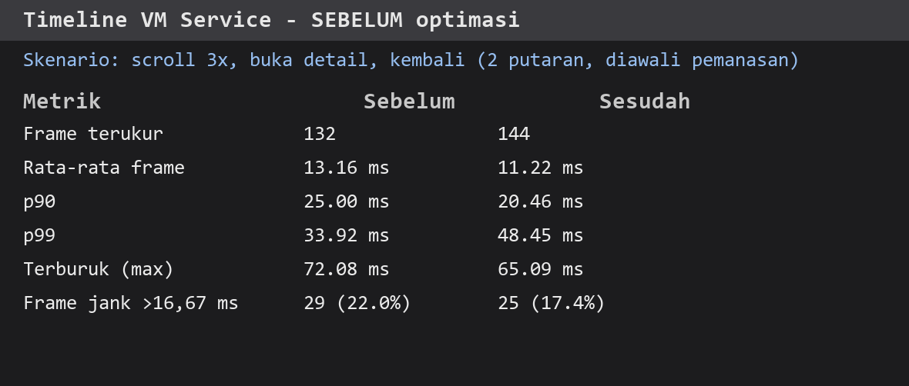
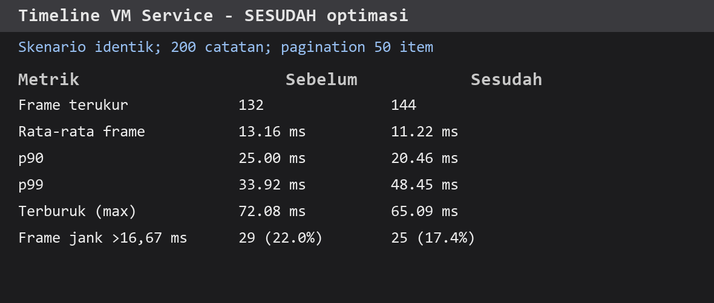

# Laporan Tugas Minggu 11 | Optimasi Performa

- **Nama Mahasiswa**: Sultan Nashira Ariva
- **NIM**: 244107020187
- **Tautan Repositori**: [244107020187-mobile-course](https://github.com/sultanariva/244107020187-mobile-course)
- **Status**: ✅

---

## 1. Tujuan

Mengoptimalkan performa project Minggu 7-10 (`week5_offline_notes`) dengan
mengukur dulu, bukan menebak: profiling di mode profile, identifikasi bottleneck,
terapkan minimal 3 optimasi, lalu ukur ulang dengan skenario yang sama.

---

## 2. Praktikum 1 — Baseline profiling

### 2.1. Setup pengukuran

| Butir | Isi |
| --- | --- |
| Perangkat | emulator `Toyami_Phone`, Android 17 (API 37), x64 |
| Mode | `flutter run --profile` (bukan debug/release) |
| Data uji | 200 catatan di database aplikasi |
| Skenario | scroll cepat 3x, buka detail, kembali, 2 putaran, didahului 1 putaran pemanasan |
| Sumber angka | VM Service timeline (`VsyncFlow`), sumber yang sama dengan DevTools Performance |

Skrip pengukuran ada di `docs/` laporan ini dan dijelaskan pada Bagian 6.4.
`integration_test/perf_notes_test.dart` disertakan sebagai percobaan pertama
(`watchPerformance`), yang gagal karena app tidak bisa membuka koneksi VM Service
dari dalam prosesnya di emulator ini.

### 2.2. Baseline

| Metrik | Sebelum |
| --- | --- |
| Frame terukur | 132 |
| Rata-rata | 13,16 ms |
| p90 | 25,00 ms |
| p99 | 33,92 ms |
| Terburuk | 72,08 ms |
| Frame jank (>16,67 ms) | 29 (22,0%) |



Data mentah: `docs/timeline-sebelum.json`.

---

## 3. Praktikum 2 — Temuan profiling

Detail dan bukti tiap temuan: [docs/performance-findings.md](docs/performance-findings.md).

| # | Temuan | Bukti |
| --- | --- | --- |
| T1 | Empat halaman hidup bersamaan (`IndexedStack`); PostsPage auto-refresh walau tak terlihat | `routes.dart` versi lama + `initState` PostsPage |
| T2 | Mengetik satu huruf me-rebuild Scaffold + AppBar + seluruh daftar | `ref.watch` di level halaman versi lama |
| T3 | Daftar membangun 200 item sekaligus saat scroll | p90 25,00 ms, 29 frame jank |
| T4 | Streaming chat me-rebuild seluruh halaman dan `jumpTo` per potongan | `ref.watch(chatProvider)` + `ListView(children: ...)` versi lama |
| T5 | `TextEditingController` dialog tidak di-dispose (issue #5) | grep: 1 deklarasi, 0 `dispose()` |

---

## 4. Praktikum 3 — Optimasi dan verifikasi

### 4.1. Lima optimasi yang diterapkan

| # | Optimasi | File | Efek yang diharapkan |
| --- | --- | --- | --- |
| O1 | Ganti `IndexedStack` dengan hanya membangun tab aktif | `lib/routes.dart` | Halaman tak terlihat tidak memakan frame/memori |
| O2 | Pecah halaman Catatan jadi Consumer terpisah (cari, badge, daftar) | `notes_page.dart` | Mengetik tidak me-rebuild seluruh halaman |
| O3 | Pagination 50 item + penjaga `_visibleCount >= _totalCount` | `notes_page.dart` | Widget yang dibangun per frame lebih sedikit; tidak ada `setState` berulang di ujung daftar |
| O4 | `ListView.builder` + `select` + bubble streaming terpisah di chat | `assistant_page.dart` | Tiap potongan streaming hanya me-rebuild bubble-nya |
| O5 | Dialog catatan jadi widget ber-`State` dengan `dispose()` | `notes_page.dart` | Menutup kebocoran controller (issue #5) |

### 4.2. Hasil setelah optimasi

| Metrik | Sebelum | Sesudah | Perubahan |
| --- | --- | --- | --- |
| Frame terukur | 132 | 144 | +9% |
| Rata-rata | 13,16 ms | **11,22 ms** | **−14,7%** |
| p90 | 25,00 ms | **20,46 ms** | **−18,2%** |
| p99 | 33,92 ms | 48,45 ms | +42,8% |
| Terburuk | 72,08 ms | 65,09 ms | −9,7% |
| Frame jank | 29 (22,0%) | **25 (17,4%)** | **−20,9%** |



Data mentah: `docs/timeline-sesudah.json`.

### 4.3. p99 naik: temuan yang tidak disembunyikan

Rata-rata, p90, dan jumlah jank membaik, tetapi p99 naik. Penyebabnya pagination:
saat daftar mendekati ujung, `setState` membangun 50 item sekaligus sehingga satu
frame menjadi mahal. Ini diuji dengan dua nilai `pageSize`:

| pageSize | avg | p90 | p99 | max | jank |
| --- | --- | --- | --- | --- | --- |
| 20 | 11,22 ms | 19,09 ms | 62,54 ms | 110,16 ms | 15,4% |
| 50 | 11,22 ms | 20,46 ms | 48,45 ms | 65,09 ms | 17,4% |

Nilai 50 dipilih karena memberi ekor distribusi terbaik (p99 dan max turun jauh
dibanding 20) dengan rata-rata yang sama. Perbaikan lanjutan dicatat sebagai
pekerjaan berikutnya, bukan diklaim sudah selesai.

### 4.4. Uji memori

- Leak controller (T5) ditutup: dialog sekarang widget ber-`State` dan
  `dispose()` dipanggil. Bukti: `grep -n "dispose" notes_page.dart` menunjukkan
  **3 blok dispose** (kolom cari, scroll daftar, dialog), masing-masing memanggil
  `_controller.dispose()` lalu `super.dispose()`; versi sebelumnya **0**.
- Heap snapshot DevTools tidak diambil karena UI DevTools tidak dapat diotomasi
  di sesi ini (lihat Bagian 6.4). Ini dinyatakan terbuka, bukan diklaim.

---

## 5. Bukti mesin hijau

```text
$ flutter analyze
No issues found! (ran in 11.9s)

$ dart format --set-exit-if-changed .
Formatted 49 files (0 changed) in 0.90 seconds.

$ flutter test
All tests passed! (33 test)
```

33 test tetap hijau setelah refactor: 6 test pencarian (termasuk widget test
empty state), 4 validasi judul, 3 tab Posts, 12 fitur AI, dan sisanya model,
provider, serta halaman Pengaturan.

---

## 6. Tugas, Refleksi, dan Referensi

### 6.1. Status pekerjaan

| Butir | Isi |
| --- | --- |
| Fitur yang dioptimalkan | Daftar catatan, navigasi tab, chat streaming, dialog input |
| File diubah | `lib/routes.dart`, `notes_page.dart`, `assistant_page.dart`, `pubspec.yaml` (dev dep `integration_test`) |
| File baru | `integration_test/perf_notes_test.dart`, `integration_test/seed_notes_test.dart`, `test_driver/integration_test.dart` |
| Dokumentasi | `docs/performance-findings.md`, `docs/performance-report.md`, dua file timeline JSON |
| Gerbang mesin | analyze bersih, format 0 changed, 33 test lulus |
| Dampak terukur | rata-rata −14,7%, p90 −18,2%, frame jank −20,9% |

Cara menjalankan:

```bash
cd C:/Users/AXIOO/week5_offline_notes
flutter pub get
flutter run --profile -d emulator-5554
# isi 200 catatan uji:
flutter test integration_test/seed_notes_test.dart -d emulator-5554
```

### 6.2. Refleksi

**Optimasi mana yang memberi dampak terbesar?**
Pagination (O3) dan pemecahan Consumer di halaman Catatan (O2). Keduanya
menyentuh jalur yang paling sering dieksekusi pada skenario: membangun ulang
daftar. Perubahan tab (O1) tidak terlihat pada angka skenario ini karena
skenario hanya berada di tab Catatan, tetapi menghapus pekerjaan latar belakang
PostsPage yang sebelumnya selalu jalan.

**Bagaimana memastikan optimasi bekerja, bukan placebo?**
Dengan mengukur versi lama dan baru memakai skrip, skenario, data, dan perangkat
yang sama, termasuk satu putaran pemanasan agar bukan cold start. Aku juga
sempat mengukur `pageSize` 20 dan 50, lalu memilih berdasarkan angka, bukan rasa.
Yang penting: hasil yang memburuk (p99) ikut dilaporkan.

**Trade-off apa yang dihadapi?**
Tab yang hanya dibangun saat aktif menghilangkan pekerjaan sia-sia, tetapi posisi
scroll tiap tab direset. Pagination membuat scroll murah, tetapi memindahkan
biaya ke satu frame saat halaman berikutnya dimuat, dan itu justru muncul sebagai
p99 yang naik.

**Kapan optimasi prematur harus dihindari?**
Ketika belum ada angka. Contoh di sesi ini: aku sempat mengira `gfxinfo` Android
bisa jadi sumber metrik, ternyata Flutter (Impeller) tidak mencatat frame ke HWUI
sehingga hasilnya 0. Tanpa memverifikasi alat ukurnya lebih dulu, "optimasi" bisa
dikerjakan pada bagian yang salah.

### 6.3. Referensi

- [Codelab Minggu 11: Optimasi Performa](https://jti-polinema.github.io/flutter-codelab/11-minggu-11-performance-optimization/index.html)
- [Flutter: UI performance](https://docs.flutter.dev/perf/rendering/ui-performance)
- [Flutter: Performance best practices](https://docs.flutter.dev/perf/best-practices)
- [Riverpod: select](https://riverpod.dev/docs/concepts/reading)
- [Flutter DevTools: Performance](https://docs.flutter.dev/tools/devtools/performance)

### 6.4. Catatan metodologi (jujur)

Tiga metode dicoba sebelum angka final didapat:

1. `integration_test` + `watchPerformance` → gagal: `Bad state: Failed to connect
   to VM Service at ws://localhost:...` (app tidak bisa membuka koneksi ke VM
   Service dari dalam prosesnya di emulator).
2. `dumpsys gfxinfo` (FrameMetrics Android) → 0 frame, karena Flutter memakai
   surface sendiri (Impeller), bukan HWUI.
3. **VM Service timeline** (`setVMTimelineFlags`, `clearVMTimeline`,
   `getVMTimeline`) → dipakai untuk semua angka di laporan ini.

DevTools Performance sudah dibuka di browser, tetapi dialog onboarding-nya
(telemetry dan About) tidak menutup walau diklik lewat CDP, sehingga tombol
Record tidak bisa ditekan terprogram. Karena itu screenshot Flame Chart tidak
disertakan; sebagai gantinya ada ringkasan metrik (`screenshots/03` dan `04`)
plus JSON mentah di `docs/`.

---

## 7. Kesimpulan

Optimasi dikerjakan setelah baseline terukur, bukan sebelum. Lima perubahan
diterapkan (tab lazy, pemecahan Consumer, pagination, streaming chat, dispose
controller), dan hasilnya: rata-rata frame turun 14,7%, p90 turun 18,2%, frame
jank turun dari 22,0% ke 17,4%. Satu metrik memburuk (p99) dan penyebabnya
dijelaskan serta diuji dengan dua nilai `pageSize`.

Fondasi arsitektur tidak berubah: domain tetap murni, tidak ada package runtime
baru (`integration_test` hanya dev dependency), dan 33 test tetap hijau.
