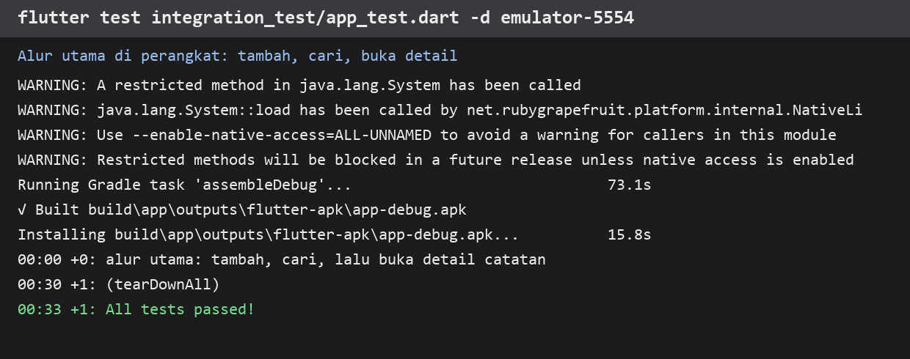
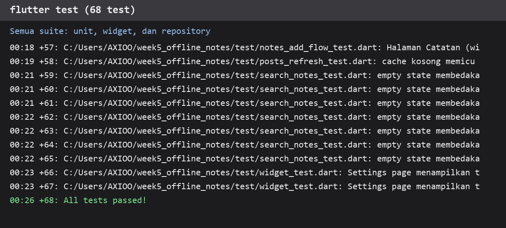
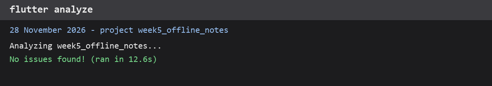

# Laporan Tugas Minggu 12 | Pengujian dan Jaminan Kualitas

- **Nama Mahasiswa**: Sultan Nashira Ariva
- **NIM**: 244107020187
- **Tautan Repositori**: [244107020187-mobile-course](https://github.com/sultanariva/244107020187-mobile-course)
- **Status**: ✅

---

## 1. Tujuan

Menutup celah kualitas project `week5_offline_notes` dengan pengujian berlapis:
unit test untuk aturan bisnis, widget test untuk perilaku UI, integration test
untuk alur utama di perangkat, lalu mengukur coverage dan meninjau cabang yang
penting (bukan mengejar persentase).

---

## 2. Ringkasan hasil

| Ukuran | Sebelum | Sesudah |
| --- | --- | --- |
| Test unit + widget | 33 | **68** |
| Integration test alur utama | belum ada | **1 (lulus di emulator)** |
| Coverage baris | 442/710 (62,3%) | **582/710 (82,0%)** |
| `flutter analyze` | bersih | bersih |

Sebanyak **35 test baru** di minggu ini, tersebar di 6 berkas:

| Berkas baru | Test | Yang ditutup |
| --- | --- | --- |
| `test/note_repository_impl_test.dart` | 6 | SQLite nyata (in-memory) untuk catatan |
| `test/post_repository_impl_test.dart` | 7 | Cache-first posts: jaringan, cache, data korup |
| `test/post_model_test.dart` | 6 | Mapping JSON ↔ entity, payload cache |
| `test/sync_notes_test.dart` | 4 | Antrean sinkronisasi |
| `test/assistant_repository_impl_test.dart` | 9 | Streaming SSE + tujuh jalur kegagalan HTTP |
| `test/notes_add_flow_test.dart` | 3 | Alur tambah catatan di UI |

Plus `integration_test/app_test.dart` untuk alur utama di perangkat.

---

## 3. Praktikum 1 — Unit test dan pemisahan dependensi

### 3.1. Tiga cara mengganti dependensi luar

| Lapisan yang diuji | Pengganti | Alasan |
| --- | --- | --- |
| SQLite (notes, posts) | `sqflite_common_ffi` dengan `inMemoryDatabasePath` | SQL benar-benar dieksekusi tanpa menyentuh file perangkat; cepat dan deterministik |
| HTTP (posts, asisten) | `HttpClientAdapter` palsu di Dio | Tidak ada jaringan sungguhan, status code bisa diatur (200/401/429/putus) |
| Konfigurasi AI | `AiConfigRepository` palsu | API key dan base URL dikendalikan test, tanpa `flutter_secure_storage` |

Dev dependency baru: `sqflite_common_ffi`. Tidak ada dependency runtime baru.

### 3.2. Contoh: menguji SQLite tanpa perangkat

```dart
setUpAll(sqfliteFfiInit);

setUp(() async {
  db = await databaseFactoryFfi.openDatabase(inMemoryDatabasePath);
  await db.execute(_createNotes); // skema sama dengan database.dart
  repository = NoteRepositoryImpl(() async => db);
});
```

Yang diuji: simpan lalu baca, urutan `updated_at`, id yang tidak ada,
hapus, `countDirty` + `markAllSynced`, dan database yang ditutup harus menjadi
`LocalFailure` (bukan exception yang bocor).

### 3.3. Contoh: menguji kegagalan HTTP tanpa jaringan

```dart
final adapter = FakeAdapter(
  (_) async => ResponseBody.fromString('unauthorized', 401),
);
final repository = AssistantRepositoryImpl(
  config: FakeAiConfig(),
  dio: Dio()..httpClientAdapter = adapter,
);

await expectLater(
  repository.streamAnswer(const [ChatMessage.user('x')]),
  emitsError(isA<ConfigurationFailure>()),
);
```

Sembilan test: dua jalur sukses (streaming dan isi payload) plus tujuh jalur
kegagalan (tanpa API key, 401, 429, 3xx, 5xx, koneksi putus, stream terputus di
tengah). Semuanya harus menjadi `Failure` yang bisa ditampilkan UI, bukan
`DioException` mentah.

Satu temuan muncul saat menulis test ini: untuk 5xx, pesan yang sampai ke
pengguna adalah `Gagal memanggil layanan AI: ...` tanpa kode status, karena Dio
melempar `DioException` sebelum cabang `status >= 300` di repository tercapai.
Perilakunya tidak salah (tetap `NetworkFailure`), tetapi pesannya kurang
spesifik; dicatat sebagai temuan **U7**, bukan langsung diubah di minggu ini.

---

## 4. Praktikum 2 — Widget test

| Skenario | Berkas | Hasil |
| --- | --- | --- |
| Daftar menampilkan catatan yang sudah ada | `notes_add_flow_test.dart` | Lulus |
| Judul kosong → SnackBar `Judul catatan tidak boleh kosong`, data tidak bertambah | `notes_add_flow_test.dart` | Lulus |
| Judul valid → baris baru muncul, spasi tepi dirapikan | `notes_add_flow_test.dart` | Lulus |
| Tanpa API key → peringatan, bukan percakapan kosong | `assistant_page_test.dart` | Lulus |
| Jawaban streaming tampil utuh setelah stream selesai | `assistant_page_test.dart` | Lulus |
| Kegagalan jaringan → kartu error dengan tombol ulang | `assistant_page_test.dart` | Lulus |
| Empty state membedakan "belum ada catatan" vs "tidak cocok" | `search_notes_test.dart` | Lulus |
| Cache kosong memicu satu refresh; mode offline menahan refresh | `posts_refresh_test.dart` | Lulus |
| Toggle mode gelap tampil | `widget_test.dart` | Lulus |

Widget test memakai `ProviderScope(overrides: [noteRepositoryProvider.overrideWithValue(fake)])`
sehingga halaman diuji dengan repositori palsu, bukan SQLite perangkat.

---

## 5. Praktikum 3 — Integration test alur utama

Berkas: `integration_test/app_test.dart`. Dijalankan di emulator:

```bash
flutter test integration_test/app_test.dart -d emulator-5554
```

Alur yang diuji (semua langkah memakai widget finder, bukan koordinat layar):

1. Buka aplikasi, tunggu frame stabil.
2. Tap FAB → dialog "Catatan baru" muncul.
3. Isi judul `Catatan uji integrasi 12` → tap Simpan.
4. Catatan muncul di daftar (data asli dari SQLite perangkat).
5. Ketik `uji integrasi 12` di kolom cari → daftar menyempit.
6. Tap catatan → halaman detail terbuka (FAB hilang, judul tampil).
7. `pageBack()` → kembali ke daftar.

Hasil: **lulus dalam 36 detik**.



---

## 6. Praktikum 4 — Coverage dan analisis



Rincian per berkas dan analisis celah ada di
[docs/coverage-summary.md](docs/coverage-summary.md). Data mentah lcov:
`docs/lcov.info`.

Yang masih 0%: `data/local/database.dart` (hanya `openDatabase` + `onCreate`;
skema diuji ulang di in-memory) dan `secure_ai_config_store.dart` (butuh channel
platform `flutter_secure_storage`). Keduanya dijelaskan beserta alasannya, bukan
ditutup dengan test kosong.

Empat cabang yang sengaja diuji karena pernah atau berpotensi menjadi bug:

1. Error tidak boleh berubah menjadi data kosong (`GetNotes`, pencarian, posts).
2. Antrean sinkronisasi tidak boleh melaporkan sukses saat penandaan gagal.
3. `DioException` tidak boleh bocor ke presentation.
4. Satu baris cache korup tidak boleh menjatuhkan seluruh daftar posts.



---

## 7. Temuan yang belum terselesaikan

| # | Temuan | Dampak | Rencana |
| --- | --- | --- | --- |
| U1 | `secure_ai_config_store` baru 33% tercakup | Penyimpanan API key hanya teruji manual | Tambah integration test yang menulis/membaca key di perangkat |
| U2 | `database.dart` 0% (jalur `onCreate`) | Migrasi skema tidak teruji otomatis | Uji dengan `path_provider` palsu + `onCreate` versi 1→2 |
| U3 | Belum ada test untuk halaman detail catatan | Edit/hapus dari detail tidak terjaga | Tambah widget test + rute GoRouter |
| U4 | Integration test hanya satu alur | Alur asisten AI di perangkat belum otomatis | Butuh server tiruan (minggu 10) dijalankan saat test |
| U5 | Widget test memakai repositori palsu | Tidak menangkap bug SQL nyata di UI | Sudah dimitigasi: SQL diuji terpisah dengan SQLite in-memory |
| U6 | `p99` frame dari minggu 11 masih naik | Scroll di ujung daftar tersendat sesaat | Debounce load-more atau pagination di SQL |
| U7 | Pesan 5xx tidak menyebut kode status | Pengguna tidak tahu bedanya server error dan gangguan jaringan | Tangkap `DioException.badResponse` dan sertakan `response.statusCode` |

---

## 8. Refleksi

**Apa bedanya menguji dengan fake dan menguji dengan SQLite sungguhan?**
Fake membuktikan UI bereaksi benar terhadap hasil, tetapi tidak membuktikan SQL-nya
benar. Karena itu repository catatan diuji dengan SQLite in-memory: di situ
`ORDER BY updated_at DESC` dan penanganan baris hilang benar-benar dieksekusi.

**Kenapa coverage bukan tujuan utama?**
Angka 80,8% hanya berarti kalau cabang yang penting ikut diuji. Contoh nyata:
`search_notes` sudah 100% sejak minggu 9, tetapi `post_repository_impl` 0%
padahal menyimpan logika cache-first yang paling rawan (data korup, offline).
Minggu ini memindahkan usaha ke sana, bukan menambah test pada berkas yang sudah
hijau.

**Kapan test memberi rasa aman palsu?**
Saat test menguji implementasi, bukan perilaku. Contoh: test `SyncNotes` dibuat
memeriksa jumlah pemanggilan `markAllSynced` dan nilai `synced`, bukan urutan
baris internal. Kalau nanti implementasinya diganti (mis. batch per 10), test
tetap bermakna.

**Apa yang paling sulit?**
Menguji streaming. `ResponseBody` harus diumpankan sebagai `Stream<Uint8List>`
yang terpotong di tengah baris `data: ...` untuk membuktikan buffering di
repository benar. Test pertama gagal karena chunk dipotong tepat di tengah JSON,
dan itu justru kasus yang ingin dijaga.

---

## 9. Referensi

- [Codelab Minggu 12: Pengujian dan Jaminan Kualitas](https://jti-polinema.github.io/flutter-codelab/12-minggu-12-testing-quality-assurance/index.html)
- [Flutter: Testing overview](https://docs.flutter.dev/testing/overview)
- [Flutter: Integration testing](https://docs.flutter.dev/testing/integration-tests)
- [sqflite_common_ffi](https://pub.dev/packages/sqflite_common_ffi)
- [Dio: HttpClientAdapter](https://pub.dev/documentation/dio/latest/dio/HttpClientAdapter-class.html)
- [Riverpod: Testing](https://riverpod.dev/docs/essentials/testing)

---

## 10. Kesimpulan

68 test dan 1 integration test hijau, coverage naik dari 62,3% ke 82,0%, dan
`flutter analyze` bersih. Yang lebih penting: lapisan data yang sebelumnya tidak
tersentuh (SQLite, Dio, mapping, cache) sekarang diuji dengan dependensi asli
yang dijalankan di memori, termasuk tujuh jalur kegagalan HTTP dan data cache
yang korup. Celah yang tersisa dicatat sebagai U1-U7, bukan disembunyikan di
balik angka coverage.
