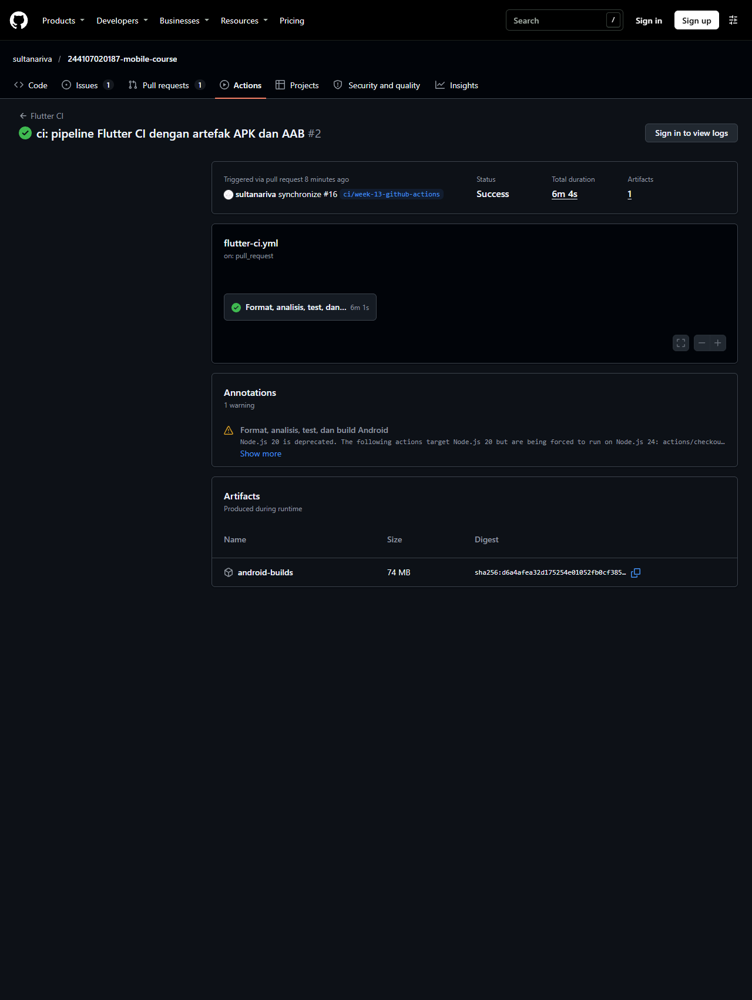
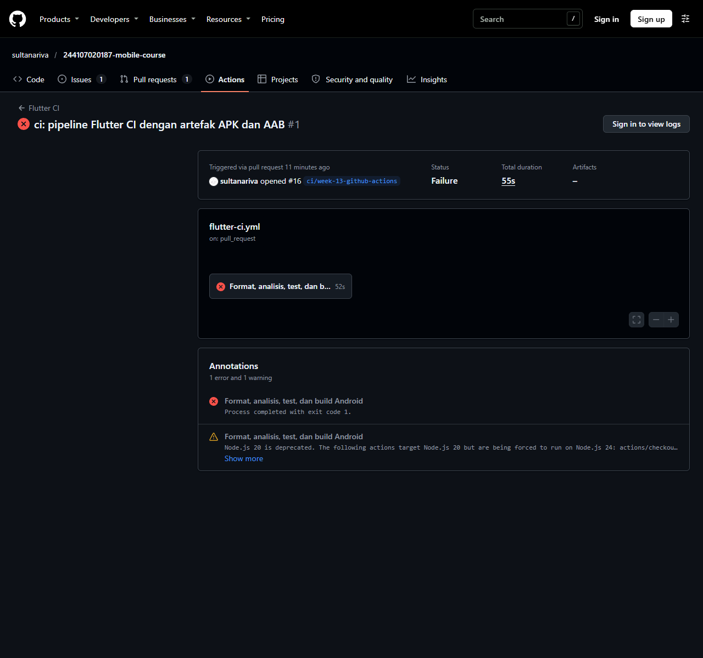

# Laporan Tugas Minggu 13 | CI/CD dan Otomatisasi

- **Nama Mahasiswa**: Sultan Nashira Ariva
- **NIM**: 244107020187
- **Tautan Repositori**: [244107020187-mobile-course](https://github.com/sultanariva/244107020187-mobile-course)
- **Status**: ✅

---

## 1. Tujuan

Membuat pemeriksaan yang selama ini manual (format, analisis, test, build) menjadi
satu pipeline yang dijalankan otomatis pada setiap perubahan, dengan hasil yang
bisa ditinjau orang lain: artefak APK/AAB, log per langkah, dan versi yang jelas.

---

## 2. Ringkasan hasil

| Butir | Nilai |
| --- | --- |
| Berkas workflow | `.github/workflows/flutter-ci.yml` |
| Project yang dibangun | `13-week-13-ci-cd-automation/` (lib, test, android, pubspec) |
| Run sukses | [run #2 · 46155760606](https://github.com/sultanariva/244107020187-mobile-course/actions/runs/46155760606) |
| Commit yang menghasilkan | `0630dea` |
| Durasi | 6 menit 4 detik (job 6 menit 1 detik) |
| Artefak | `android-builds`, 74 MB, kedaluwarsa 5 Desember 2026 |
| Versi | `1.1.0+2`, tag `v1.1.0` |



---

## 3. Praktikum 1 — Workflow CI

```yaml
name: Flutter CI

on:
  push:
    branches: [main, develop]
  pull_request:
    branches: [main, develop]
  workflow_dispatch:

permissions:
  contents: read

concurrency:
  group: ${{ github.workflow }}-${{ github.ref }}
  cancel-in-progress: true

defaults:
  run:
    working-directory: 13-week-13-ci-cd-automation
```

| Langkah | Perintah | Gagal berarti |
| --- | --- | --- |
| Format | `dart format --output=none --set-exit-if-changed .` | ada berkas tidak terformat |
| Analisis | `flutter analyze --fatal-infos` | ada error, warning, atau info |
| Test | `flutter test --coverage` | ada test merah |
| Ringkasan coverage | `awk` membaca `coverage/lcov.info` → run summary | (tidak menggagalkan job) |

Tiga keputusan yang menyimpang dari contoh codelab, beserta alasannya:

1. **`working-directory` diarahkan ke folder minggu 13.** Repo ini repo portofolio:
   root berisi folder minggu, bukan satu project Flutter. Tanpa ini, `flutter pub get`
   di root akan gagal karena tidak ada `pubspec.yaml`.
2. **Folder minggu 13 dijadikan project lengkap, termasuk `android/`.** Folder
   minggu lain hanya berisi `lib/`, `test/`, `docs/`, `screenshots/`, sehingga
   `flutter build apk` tidak mungkin dijalankan (tidak ada folder platform).
3. **`develop` ikut jadi pemicu.** Repo memakai Git Flow (fitur → `develop` → `main`),
   jadi PR ke `develop` juga harus diperiksa. Codelab menyebut `main` saja.

---

## 4. Praktikum 2 — Build dan artefak

```yaml
      - run: flutter build apk --release
      - run: flutter build appbundle --release
      - uses: actions/upload-artifact@v4
        with:
          name: android-builds
          path: |
            13-week-13-ci-cd-automation/build/app/outputs/flutter-apk/app-release.apk
            13-week-13-ci-cd-automation/build/app/outputs/bundle/release/app-release.aab
          if-no-files-found: error
          retention-days: 7
```

Path artefak memakai prefix folder karena `upload-artifact` **tidak** mengikuti
`working-directory`. `if-no-files-found: error` penting: kalau build diam-diam
tidak menghasilkan berkas, job gagal, bukan "hijau tanpa artefak".

Artefak sudah saya unduh dan periksa isinya, bukan hanya melihat tombol unduh:

| Berkas | Ukuran | SHA-256 (hasil unduhan) |
| --- | --- | --- |
| `flutter-apk/app-release.apk` | 52 MB | `6bb8bb18166b5219229ab8e1ac7ad2037aa2321956e7e0392e78fac845e85dce` |
| `bundle/release/app-release.aab` | 51 MB | `bc321ee88ad37f60c1d288d5caca2b652559a5931641b420ab526b33c567c9ff` |

Pemeriksaan tambahan:

- `unzip -l app-release.apk` → 374 entri, `resources.arsc` ada (APK valid).
- `unzip -l app-release.aab` → `BundleConfig.pb` dan `base/manifest/AndroidManifest.xml` ada (AAB valid).
- `apksigner verify --print-certs` → `CN=Android Debug`, artinya artefak ini
  ditandatangani debug key, bukan kunci rilis.

---

## 5. Praktikum 3 — Versioning

| Butir | Nilai |
| --- | --- |
| Sebelum | `1.0.0+1` |
| Sesudah | `1.1.0+2` |
| Tag | `v1.1.0` (menunjuk commit yang lolos pipeline) |

Alasan minor, bukan patch: minggu 11 mengubah perilaku daftar catatan (pagination,
pemuatan bertahap) yang terlihat pengguna, dan itu perubahan kompatibel. Build
number naik karena artefak baru dihasilkan.

Aturan yang dipegang: `major` untuk perubahan tidak kompatibel, `minor` untuk fitur
kompatibel, `patch` untuk perbaikan, build number naik setiap unggahan.

---

## 6. Praktikum 4 — Rahasia dan konfigurasi

| Hal | Perlakuan |
| --- | --- |
| API key provider AI | tidak ada di repo; disimpan di perangkat lewat `flutter_secure_storage` |
| Keystore produksi | tidak ada di repo dan tidak dipakai workflow ini |
| `--dart-define` | tidak dipakai untuk rahasia: nilai yang dikompilasi bisa diekstrak dari APK |
| Pull request dari fork | tidak mendapat GitHub Secrets, jadi workflow ini tidak memakai `secrets:` sama sekali |
| URL API | konfigurasi publik, bukan credential |

Karena tidak ada secret, workflow aman dijalankan pada PR (termasuk dari fork).

---

## 7. Bukti run dan satu kegagalan yang jujur dicatat

### 7.1. Run pertama gagal (55 detik)



Run #1 ([46155602895](https://github.com/sultanariva/244107020187-mobile-course/actions/runs/46155602895))
gagal di langkah **Analisis statis**:

```text
13 issues found. (ran in 7.8s)
info • 'package:flutter/material.dart' is deprecated and shouldn't be used.
       Use package:material_ui/material_ui.dart instead.
```

Penyebabnya bukan kode yang berubah, tetapi versi toolchain: runner memakai
Flutter **3.50.1**, sementara mesin saya memakai **3.47.7**. Di 3.50, seluruh
import `package:flutter/material.dart` sudah ditandai deprecated, sehingga
`--fatal-infos` gagal pada 13 berkas.

Tiga pilihan yang saya pertimbangkan:

| Pilihan | Konsekuensi |
| --- | --- |
| Hapus `--fatal-infos` | Melanggar instruksi codelab; menyembunyikan masalah |
| Migrasi semua import ke `package:material_ui` | Perubahan besar di luar lingkup minggu 13, dan tidak bisa diverifikasi lokal di 3.47.7 |
| **Pin `flutter-version: 3.47.7`** | Dipilih: hasil CI sama dengan lokal, `--fatal-infos` tetap ketat, migrasi dicatat sebagai risiko R6 |

### 7.2. Run kedua sukses (6 menit 4 detik)

Semua langkah hijau: format, analisis, 68 test, coverage, build APK, build AAB,
unggah artefak. Ringkasan coverage ikut tertulis di halaman run.

---

## 8. Tugas

| Butir tugas | Status | Bukti |
| --- | --- | --- |
| Workflow CI (format, analisis, test) | ✅ | `.github/workflows/flutter-ci.yml`, run #2 hijau |
| Build APK dan AAB sebagai artefak | ✅ | `android-builds` 74 MB, 2 berkas terverifikasi |
| Jalankan lewat PR/push, sertakan bukti + commit | ✅ | PR #16, run #2, commit `0630dea` |
| Dokumentasi versi berikutnya | ✅ | `1.1.0+2`, tag `v1.1.0` |
| Dokumentasi risiko keamanan tersisa | ✅ | tabel R1-R6 di [docs/ci-cd.md](docs/ci-cd.md) |

---

## 9. Refleksi

**Masalah apa yang ditemukan otomatis sebelum perubahan di-merge?**
Run #1 menemukan bahwa kode belum siap untuk Flutter 3.50: 13 import yang akan
deprecated. Tanpa CI, temuan ini baru muncul saat saya (atau dosen) membuka
project dengan Flutter terbaru, jauh setelah PR di-merge. CI juga memastikan
format dan 68 test tetap hijau pada setiap perubahan, sesuatu yang sebelumnya
saya jalankan manual dan mudah terlewat.

**Informasi apa yang dibutuhkan untuk menyelidiki build yang gagal?**
Run ID, commit SHA, nama langkah yang gagal, dan log langkah itu. Karena itu
workflow mencatat `flutter --version` dan `java -version` di awal: tanpa itu, saya
tidak akan tahu bahwa penyebabnya perbedaan versi Flutter, bukan kode. Artefak
juga menyimpan commit asalnya, jadi APK bisa dilacak ke source yang tepat.

**Bagian mana yang masih perlu persetujuan atau pemeriksaan manual sebelum rilis?**
Signing. Artefak ini bertanda tangan debug (`CN=Android Debug`), jadi hanya layak
untuk uji internal. Rilis Play Store butuh keystore produksi lewat Secrets, review
izin aplikasi, uji di perangkat nyata, dan persetujuan pemilik akun Play Console.
Build hijau tidak sama dengan siap publikasi.

---

## 10. Referensi

- [Codelab Minggu 13: CI/CD dan Otomatisasi](https://jti-polinema.github.io/flutter-codelab/13-minggu-13-ci-cd-automation/index.html)
- [GitHub Actions documentation](https://docs.github.com/actions)
- [subosito/flutter-action](https://github.com/subosito/flutter-action)
- [actions/upload-artifact](https://github.com/actions/upload-artifact)
- [Continuous delivery with Flutter](https://docs.flutter.dev/deployment/cd)
- [Build and release an Android app](https://docs.flutter.dev/deployment/android)
- [Using secrets in GitHub Actions](https://docs.github.com/actions/security-guides/using-secrets-in-github-actions)
- [Semantic Versioning](https://semver.org/)

---

## 11. Kesimpulan

Pipeline berjalan pada setiap push dan pull request: format, `analyze --fatal-infos`,
68 test dengan coverage, lalu build APK dan AAB yang diunggah sebagai artefak
`android-builds`. Run sukses tercatat pada commit `0630dea` (6 menit 4 detik), dan
artefaknya sudah saya unduh serta verifikasi isinya.

Satu kegagalan nyata terjadi di run pertama dan tidak disembunyikan: Flutter 3.50
menandai `package:flutter/material.dart` deprecated. Solusi yang dipilih adalah
memin versi toolchain di CI, dengan migrasi ke `package:material_ui` dicatat
sebagai risiko R6 dan pekerjaan berikutnya.
